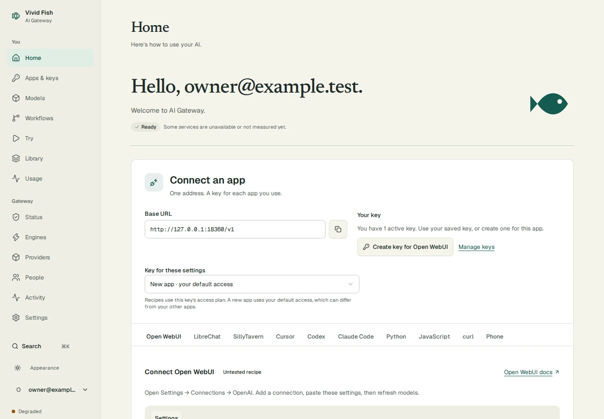
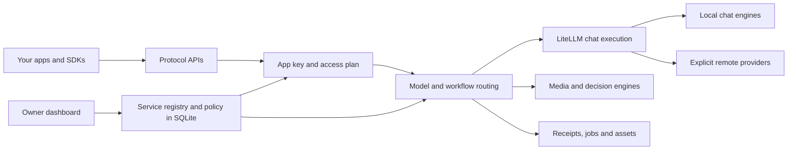

# Vivid Fish AI Gateway

**Your own AI provider: one endpoint and one key for your apps, local engines, and chosen remote providers.**



[See the Models and People screenshots](docs/assets/screenshots/README.md).

*The shipped UI at 1440 px, captured from an isolated gateway with a deterministic test engine. The sample account and request are test data.*

Keep your favorite frontend. Point Open WebUI, a coding agent, or your own app at the gateway. Run models on your hardware, add remote providers when you choose, and control access from one dashboard.

- **Use familiar APIs.** OpenAI chat, images, audio and embeddings, plus Anthropic, Ollama and other protocol facades. See the [route support matrix](docs/SUPPORT_MATRIX.md) and [protocol limits](docs/VENDOR_FACADES.md).
- **Connect engines through settings.** Register URLs and model mappings; handle engine quirks with declarative transforms. See [first-run setup](docs/FIRST_RUN_SETUP.md) and the [engine knowledge boundary](docs/design/ENGINE_KNOWLEDGE_BOUNDARY.md).
- **Share access with people.** Invite family or friends, give each app its own key, and choose an access plan. See [accounts and invitations](docs/PEOPLE_AND_ACCOUNTS.md).
- **Choose paid access explicitly.** Remote models require provider permission and pass spend checks. Unresolved charges remain visible and block capped spending. See [remote providers](docs/REMOTE_PROVIDERS.md).
- **Make more than chat.** Discover media workflows, run typed decisions, and inspect request receipts where supported. See [workflow contracts](docs/EXTENSION_ARCHITECTURE.md) and [decisions](docs/ops/DECISIONS.md).

Available capabilities depend on your engines and access plan. A registered route does not establish full vendor compatibility. Start with [the docs index](docs/README.md) for the guide that matches your task.

## Five-minute quickstart

Allow about five minutes for owner setup after the containers are ready. The first image build and model downloads can take longer. You need Docker with Compose, this repository, and a reachable OpenAI-compatible chat engine. Compose includes the gateway and its LiteLLM execution sidecar; it does not download an inference model.

1. Download or clone this repository. Open a terminal in its root. Use the tested recipe from [First-Run Setup](docs/FIRST_RUN_SETUP.md#docker-compose-quick-start) exactly:

   ```bash
   docker compose up -d
   ```

2. Open `http://127.0.0.1:5000/setup`. Create the first owner account. Continue to Home, choose your app, and use **Create key for** that app. Save the value when it appears; it is shown once. No `.env` file is required.
3. Open **Gateway → Engines**. Add your chat engine's OpenAI-compatible base URL as reachable from the gateway container. Set its health endpoint to `/v1/models`. Map a public name such as `my-llama` to the engine's actual model ID.
4. Open Home and connect an app with base URL `http://127.0.0.1:5000/openai/v1`, your App key, and `my-llama`. Use **Gateway check** to make a real gateway request, then send a message from your app to check its settings.

On Linux, Compose provides `host.docker.internal` for the host. For example, an engine with a reachable port 8080 can use `http://host.docker.internal:8080/v1`. A host engine bound only to loopback is not reachable from the container; use a reachable host address and restrict access with your firewall.

The gateway listens on host loopback by default. A client on another device needs a reachable HTTPS address. The localhost recipe uses non-secure cookies for HTTP setup; enable secure cookies before exposing it over HTTPS. Follow [reverse-proxy setup](docs/REVERSE_PROXY.md), [configuration ownership](docs/CONFIG_SOURCE_OF_TRUTH.md), and the [operator guide](docs/guides/OPERATOR.md).

## Connect your apps

Use an App key (`opk_…`) for requests. An admin key (`oak_…`) is for gateway administration. Each app can have a separate key so you can revoke one without disrupting the others.

These labels come from the [client compatibility matrix](docs/COMPATIBILITY_TARGET_MATRIX.md#current-targets-at-a-glance). **Tested** means a recorded manual smoke check, not every feature or version. **Untested** means the matrix records no verified app-level check. The [API support matrix](docs/SUPPORT_MATRIX.md) separately records routes and their limits.

| Client | Base URL / connection | Evidence |
| --- | --- | --- |
| Open WebUI | OpenAI connection: gateway root + `/openai/v1` | Tested — manual smoke |
| LibreChat | Custom OpenAI endpoint: gateway root + `/openai/v1` | Untested |
| Continue | OpenAI provider: gateway root + `/openai/v1` | Untested |
| Cline | OpenAI-compatible provider: gateway root + `/openai/v1` | Untested |
| SillyTavern | Custom OpenAI connection: gateway root + `/openai/v1` | Untested |
| Vercel AI SDK | OpenAI-compatible provider: gateway root + `/openai/v1` | Untested |
| n8n | OpenAI credential with custom base URL: gateway root + `/openai/v1` | Untested |
| HA Extended OpenAI Conversation | Custom base URL: gateway root + `/openai/v1` | Untested |

Home includes connection recipes and snippets for SDKs and coding agents. See [client recipes](docs/LOCAL_CLIENT_RECIPES.md) for protocol-specific settings. Use Models to find names your key can access. A recipe is not evidence that the whole client has been tested.

## How it fits together



The gateway owns authentication, access plans, routing, paid admission and records. LiteLLM executes chat-shaped requests. Local engines and remote providers are registered data. Engine-specific transforms are data too; core code stays independent of engine names. See [configuration ownership](docs/CONFIG_SOURCE_OF_TRUTH.md) and [the LiteLLM decision](docs/LITELLM_SUBSTRATE_DECISION.md).

## Providers and costs

Local models use your hardware. Paid remote models use provider-qualified names such as `typesafe/jev-latest`. Add its service-registry record through the admin API (or Engines when a matching preset exists), reference its key through an environment variable, and grant the relevant access plan permission. **Gateway → Providers** currently shows status and spend; it does not edit provider records or caps. Provider keys stay on the server.

Set per-request and daily or monthly budgets on the access plan. Use the provider admin API for provider or gateway caps. Estimates reserve spend before dispatch. Actual cost settles afterward; missing final cost remains unknown until reconciliation. A cap can be exceeded by the cost of requests already in flight. Use a provider-side credit limit as another control.

An unavailable local model does not silently become a paid request. Paid fallback needs explicit routing configuration and access-plan permission. See [remote-provider configuration and limits](docs/REMOTE_PROVIDERS.md) and [charge reconciliation](docs/ops/PROVIDER_RECONCILIATION.md).

## Decisions

Use `/v1/systemone` or `/typesafe/v1/systemone` for TypeSafe-shaped Choice, Score and Noul questions over shared state. Configure a local decision engine for the `decide` alias, or explicitly select a configured paid provider. Local decision aliases stay local when an engine is unavailable.

OpenAI `/v1/decisions` is a separate passthrough contract. It returns 501 without a configured provider that declares Decisions support; it does not translate to a local schema. Read [the decision guide](docs/ops/DECISIONS.md) before enabling either path.

## Workflows and media

Workflows map portable inputs to an engine graph through manifests. Discover permitted workflows at `/gateway/v1/workflows`; inspect capabilities before submitting a job. Image, video and audio execution requires the relevant engines and model files.

Use **Try** for a small API check, **Library** for your generated media, and **Usage** for request details. Receipts can explain routing, rejected inputs and cost where the execution path records them. Receipt coverage and vendor features vary by route. See [extension architecture](docs/EXTENSION_ARCHITECTURE.md), [conditioning controls](docs/CONDITIONING_CONTROLS.md), and [API targets](docs/API_TARGETS.md).

## Share with family or friends

Create an access plan, then create an invite from **Gateway → People**. Choose the plan and expiry; copy the link to the person. Invitation acceptance creates a personal App and shows its key once. Built-in email/password accounts work without an external identity provider; OIDC is also available.

The member opens Home, picks a connection recipe, and uses their own key. Give them the [member guide](docs/guides/FOR_MEMBERS.md). Invitation links are shared by the owner; the gateway does not send email or provide passkeys. [Account documentation](docs/PEOPLE_AND_ACCOUNTS.md) covers revocation and ownership rules.

## Security model

App keys are bearer credentials with access-plan permissions. Browser accounts use signed sessions and CSRF protection. Admin credentials grant control-plane access and must not be pasted into client apps. Keep provider credentials in your deployment secret store or environment.

Authenticated member access scopes jobs, assets and receipts to their App ownership. Complete signed asset URLs remain bearer capabilities until expiry, so treat shared download links as private. Historical records without trusted ownership are hidden from scoped users. Disabling authentication removes that isolation boundary.

Put remote access behind TLS, keep secure cookies enabled there, and back up durable state and signing secrets. Review [the security policy](SECURITY.md), [authentication guide](AUTH_GUIDE.md), and [operator guide](docs/guides/OPERATOR.md) before sharing an instance.

## Contributing

Start with [CONTRIBUTING.md](CONTRIBUTING.md). It covers local setup, hermetic tests and data-based engine integrations. See [the contributor docs](docs/README.md#contributor) for architecture and design references. Keep changes small and include evidence for the behavior you change.

## License

[Apache License 2.0](LICENSE).
