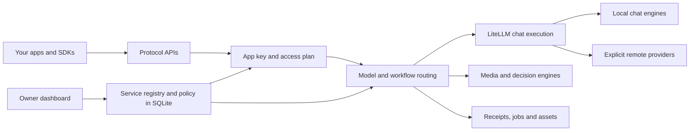

# Azizam

**Your own AI provider: one endpoint and one key for your apps, local engines, and chosen remote providers.**


[See the Models and People screenshots](docs/assets/screenshots/README.md).

*The shipped UI at 1440 px, captured from an isolated gateway with a deterministic test engine. The sample account and request are test data.*

Keep your favorite frontend. Point Open WebUI, a coding agent, or your own app at the gateway. Run models on your hardware, add remote providers when you choose, and control access from one dashboard.

- **Use familiar APIs.** OpenAI chat, images, audio and embeddings, plus Anthropic, Ollama and other protocol facades. See the [route support matrix](docs/SUPPORT_MATRIX.md) and [protocol limits](docs/VENDOR_FACADES.md).
- **Connect engines through settings.** Register URLs and model mappings; handle engine quirks with declarative transforms. See [first-run setup](docs/FIRST_RUN_SETUP.md) and the [engine knowledge boundary](docs/design/ENGINE_KNOWLEDGE_BOUNDARY.md).
- **Share access with people.** Invite family or friends, give each app its own key, and choose an access plan. See [accounts and invitations](docs/PEOPLE_AND_ACCOUNTS.md).
- **Choose paid access explicitly.** Remote models require provider permission and pass spend checks. Unresolved charges remain visible and block capped spending. See [remote providers](docs/REMOTE_PROVIDERS.md).
- **Make more than chat.** Discover media workflows, run typed decisions, and inspect request receipts where supported. See [workflow contracts](docs/EXTENSION_ARCHITECTURE.md) and [decisions](docs/ops/DECISIONS.md).

Available capabilities depend on your engines and access plan. A registered route does not establish full vendor compatibility. Visit [azizam.dev](https://azizam.dev) for the public site and documentation, or browse [the repository docs index](docs/README.md).

## Quickstart

You need an inference engine: a server that runs the model, such as llama.cpp, vLLM, LM Studio or Ollama. The gateway does not include an engine or download a model.

Use Docker Compose, or run without Docker: [bare-metal install](docs/FIRST_RUN_SETUP.md#bare-metal-install-no-docker). The steps below use Compose. No `.env` file is required.

1. Start the gateway. Open a terminal in this repository's folder and run:

   ```bash
   docker compose up -d
   ```

   The first start builds the gateway image. This can take several minutes.

2. Check that the gateway answers:

   ```bash
   curl -i http://127.0.0.1:5000/health
   ```

   The first line of the reply should be `HTTP/1.1 200 OK`. If you set `AZIZAM_PORT`, use that port in every URL here.

3. Create the owner account. Open `http://127.0.0.1:5000/setup/`. Enter an email address, a password, and the password again. This account owns the gateway.

4. Create an App key. Open **Home**, choose your app, and click **Create key for** that app. The key starts with `opk_`. Copy it now. It is shown only once.

5. Add your engine. Open **Gateway → Engines**, then click **Add engine**.
   - For llama.cpp, vLLM, LM Studio or another OpenAI-compatible server, choose **Any OpenAI-compatible server**. Type an address that ends in `/v1`, such as `http://192.168.1.50:8080/v1`.
   - For Ollama, choose **Server with its own model list**. Type the address with no `/v1`, such as `http://192.168.1.50:11434`.

   The address must work from where the gateway runs. Read [Connect an engine by where it runs](docs/FIRST_RUN_SETUP.md#connect-an-engine-by-where-it-runs) first. The dialog has several steps, and each has a **Continue** button. **Continue** sends a few harmless requests to the server. Nothing is saved yet. If the server needs a key, enter the engine's key there. Do not enter your App key. Tick the abilities you want, such as chat. Keep or rename the model names it found, then name the engine and click **Add engine**.

   Write down the public model name you kept, such as `my-llama`. Your app sends this name.

6. Connect your app with these values:
   - Base URL: `http://127.0.0.1:5000/openai/v1`
   - API key: your App key (`opk_…`)
   - Model: the public model name from step 5

   Check the key and the model list with one request:

   ```bash
   curl -s http://127.0.0.1:5000/openai/v1/models \
     -H "Authorization: Bearer opk_YOUR_KEY_HERE"
   ```

   Then send a message from your app. Open **Usage** to see its request record.

Compose publishes the gateway only on `127.0.0.1`, using port `5000` by default. State and cache use the named volumes `gateway-data` and `gateway-cache`. See [First-Run Setup](docs/FIRST_RUN_SETUP.md#docker-compose-quick-start) for more detail.

An engine on another computer, or one run on this computer but not on loopback, needs a listener and a firewall setting. Clients on another device, or in another container, need a different base URL. The [first-run guide](docs/FIRST_RUN_SETUP.md#connect-an-engine-by-where-it-runs) gives the exact values for each layout.

The loopback description here is specific to the Compose quickstart. Do not assume every launch mode binds only to loopback. The checked-in `proxy_config.yml` sets `proxy.host` to `0.0.0.0` and does not grant keyless LAN access. Check the effective listener, published ports, trusted proxies and App trusted addresses before exposing the gateway. A client on another device needs a reachable HTTPS address. The localhost recipe uses non-secure cookies for HTTP setup; enable secure cookies before exposing it over HTTPS. Follow [reverse-proxy setup](docs/REVERSE_PROXY.md), [configuration ownership](docs/CONFIG_SOURCE_OF_TRUTH.md), and the [operator guide](docs/guides/OPERATOR.md).

## Connect your apps

Use an App key (`opk_…`) for requests. An admin key (`oak_…`) is for gateway administration. Each app can have a separate key so you can revoke one without disrupting the others.

A protected API request without a key returns `401 key_required`, unless an owner has added the client address to an App under **Apps & keys → app menu → Trusted addresses**. That request uses the App's access plan. A sent key always takes priority; a placeholder such as `loopback` returns `401 key_invalid`. Forwarded client addresses count only when the proxy is in `auth.trusted_proxies`.

These labels come from the [client compatibility matrix](docs/COMPATIBILITY_TARGET_MATRIX.md#current-targets-at-a-glance). **Tested** means a recorded manual smoke check, not every feature or version. **Untested** means the matrix records no verified app-level check. The [API support matrix](docs/SUPPORT_MATRIX.md) separately records routes and their limits.

| Client | Base URL / connection | Evidence |
| --- | --- | --- |
| Open WebUI | OpenAI connection: gateway root + `/openai/v1` | Tested — manual smoke |
| LibreChat | Custom OpenAI endpoint: gateway root + `/openai/v1` | Untested |
| Continue | OpenAI provider: gateway root + `/openai/v1` | Untested |
| Cline | OpenAI-compatible provider: gateway root + `/openai/v1` | Untested |
| SillyTavern | Custom OpenAI connection: gateway root + `/openai/v1` | Untested |
| Vercel AI SDK | OpenAI-compatible provider: gateway root + `/openai/v1` | Untested |
| n8n | OpenAI credential with custom base URL: gateway root + `/openai/v1` | Untested |
| HA Extended OpenAI Conversation | Custom base URL: gateway root + `/openai/v1` | Untested |

Home includes connection recipes and snippets for SDKs and coding agents. See [client recipes](docs/LOCAL_CLIENT_RECIPES.md) for protocol-specific settings. Use Models to find names your key can access. A recipe is not evidence that the whole client has been tested.

## How it fits together



The gateway owns authentication, access plans, routing, paid admission and records. LiteLLM executes chat-shaped requests. Local engines and remote providers are registered data. Engine-specific transforms are data too; core code stays independent of engine names. See [configuration ownership](docs/CONFIG_SOURCE_OF_TRUTH.md) and [the LiteLLM decision](docs/LITELLM_SUBSTRATE_DECISION.md).

## Providers and costs

Local models use your hardware. Paid remote models use provider-qualified names such as `typesafe/jev-latest`. Use **Gateway → Providers → Add provider** to select an endpoint, enter a write-only key or environment-variable reference, choose models and prices, and set caps and allowed access plans. The page also shows status and spend. See [key custody and backups](docs/REMOTE_PROVIDERS.md#key-custody-and-threat-model) for how server-side credentials are stored.

Set per-request and daily or monthly budgets on the access plan. Use Providers or the provider admin API for provider or gateway caps. Estimates reserve spend before dispatch. Actual cost settles afterward; missing final cost remains unknown until reconciliation. A cap can be exceeded by the cost of requests already in flight. Use a provider-side credit limit as another control.

An unavailable local model does not silently become a paid request. Paid fallback needs explicit routing configuration and access-plan permission. See [remote-provider configuration and limits](docs/REMOTE_PROVIDERS.md) and [charge reconciliation](docs/ops/PROVIDER_RECONCILIATION.md).

## Decisions

Use `/v1/systemone` or `/typesafe/v1/systemone` for TypeSafe-shaped Choice, Score and Noul questions over shared state. Configure a local decision engine for the `decide` alias, or explicitly select a configured paid provider. Local decision aliases stay local when an engine is unavailable.

OpenAI `/v1/decisions` is a separate passthrough contract. It returns 501 without a configured provider that declares Decisions support; it does not translate to a local schema. Read [the decision guide](docs/ops/DECISIONS.md) before enabling either path.

## Workflows and media

Workflows map portable inputs to an engine graph through manifests. Discover permitted workflows at `/gateway/v1/workflows`; inspect capabilities before submitting a job. Image, video and audio execution requires the relevant engines and model files.

Use **Try** for a small API check, **Library** for your generated media, and **Usage** for request details. Receipts can explain routing, rejected inputs and cost where the execution path records them. Receipt coverage and vendor features vary by route. See [extension architecture](docs/EXTENSION_ARCHITECTURE.md), [conditioning controls](docs/CONDITIONING_CONTROLS.md), and [API targets](docs/API_TARGETS.md).

## Share with family or friends

Create an access plan, then create an invite from **Gateway → People**. Choose the plan and expiry; copy the link to the person. Invitation acceptance creates a personal App and shows its key once. Built-in email/password accounts work without an external identity provider; OIDC is also available.

The member opens Home, picks a connection recipe, and uses their own key. Give them the [member guide](docs/guides/FOR_MEMBERS.md). Invitation links are shared by the owner; the gateway does not send email or provide passkeys. [Account documentation](docs/PEOPLE_AND_ACCOUNTS.md) covers revocation and ownership rules.

## Security model

App keys are bearer credentials with access-plan permissions. Browser accounts use signed sessions and CSRF protection. Admin credentials grant control-plane access and must not be pasted into client apps. Enter provider credentials as write-only keys in Providers, or reference the gateway service environment. See [key custody](docs/REMOTE_PROVIDERS.md#key-custody-and-threat-model) for encryption and backup requirements.

Signed-in Library, Jobs and Usage access defaults to the person's own work. Ownership can come from owned Apps or trusted user/App principal and credential-hash records. Owners and superadmins can explicitly inspect broader Library or Usage scopes. The Jobs endpoints and Library deletion stay self-scoped. Broader media visibility does not grant another person's saved prompt or full-metadata download. Complete signed asset URLs remain bearer capabilities until expiry, so treat shared download links as private. Historical records without trusted ownership are hidden from scoped users. Authentication cannot be disabled.

Put remote access behind TLS, keep secure cookies enabled there, and back up durable state and signing secrets. Review [the security policy](SECURITY.md), [authentication guide](AUTH_GUIDE.md), and [operator guide](docs/guides/OPERATOR.md) before sharing an instance.

## Contributing

Start with [CONTRIBUTING.md](CONTRIBUTING.md). It covers local setup, hermetic tests and data-based engine integrations. See [the contributor docs](docs/README.md#contributor) for architecture and design references. Keep changes small and include evidence for the behavior you change.

## License

[Apache License 2.0](LICENSE).
