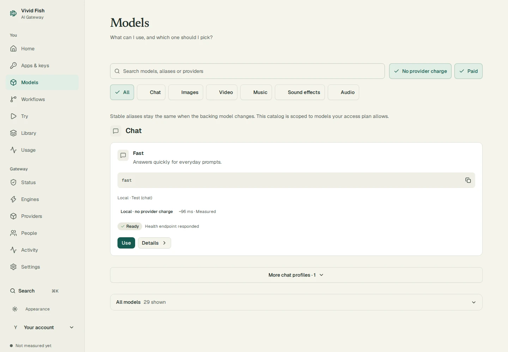
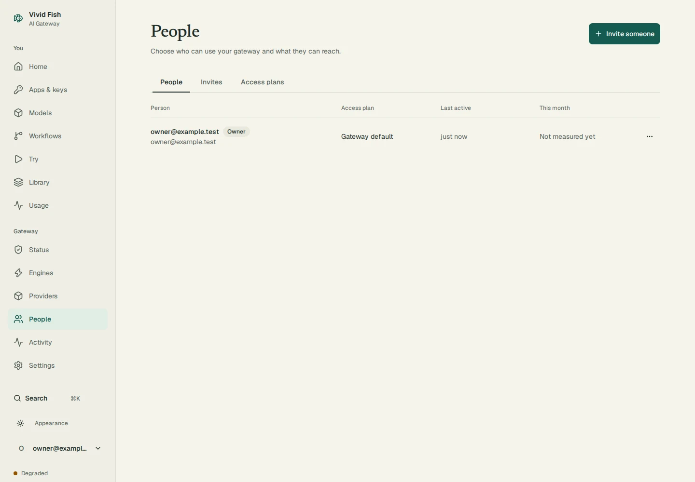

# Documentation screenshots

These are real pages from the current static UI export, served by a throwaway gateway. The existing browser-test seed creates an example owner, service, access plan, App key and successful request through HTTP APIs. The engine returns a deterministic test answer. No operator database, provider key or live service is used.

The screenshots use light mode, a 1440 × 1000 viewport and a device scale of 1. Each WebP is under 300 KB. Home shows app connection settings, Models shows the current catalog with the test engine's measured response time and health, and People shows the example owner. Unmeasured gateway health and monthly usage remain visible; no response or telemetry is fabricated for the capture.

The same capture run also writes Home, Models, Workflows, Try, Providers, Library, Status and People in both light and dark mode to `web/test-results/product/`. These product-site images use a 1440 × 960 viewport and the same seeded gateway. Library is empty because the seed creates no media; Providers shows the disabled provider seed with no key or paid requests. Try shows its initial request panel. No browser API responses are replaced for these captures.

Reproduce from a dependency-installed checkout with the UI built. Run `web/e2e/seed-review.mjs` from `web/`, passing `node ../docs/assets/screenshots/capture.mjs` as its review command. Set `UI_E2E_PORT` to an unused port in 18000–18998. The capture script requires the worktree's `venv/bin/python` with Pillow to compress the images. The supervisor stops both test processes and removes temporary gateway state after capture.

```sh
cd web
UI_E2E_PORT=18380 node e2e/seed-review.mjs node ../docs/assets/screenshots/capture.mjs
```

The capture checks each page's HTTP status, settled loading state, heading, horizontal fit and compressed image size before completing.

## Tour




