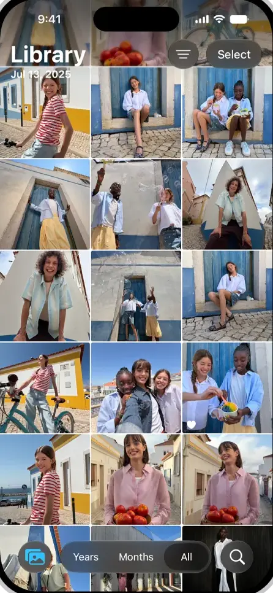
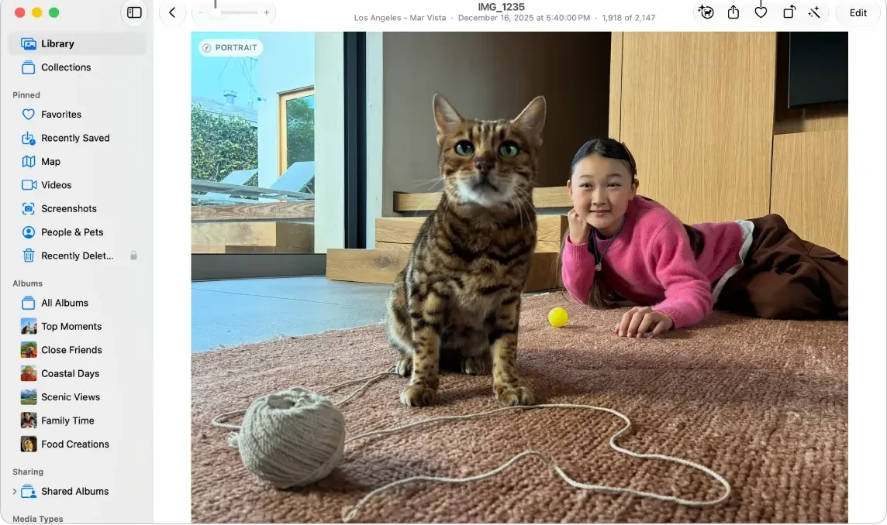
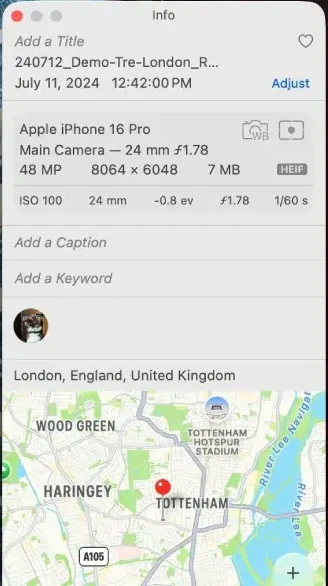
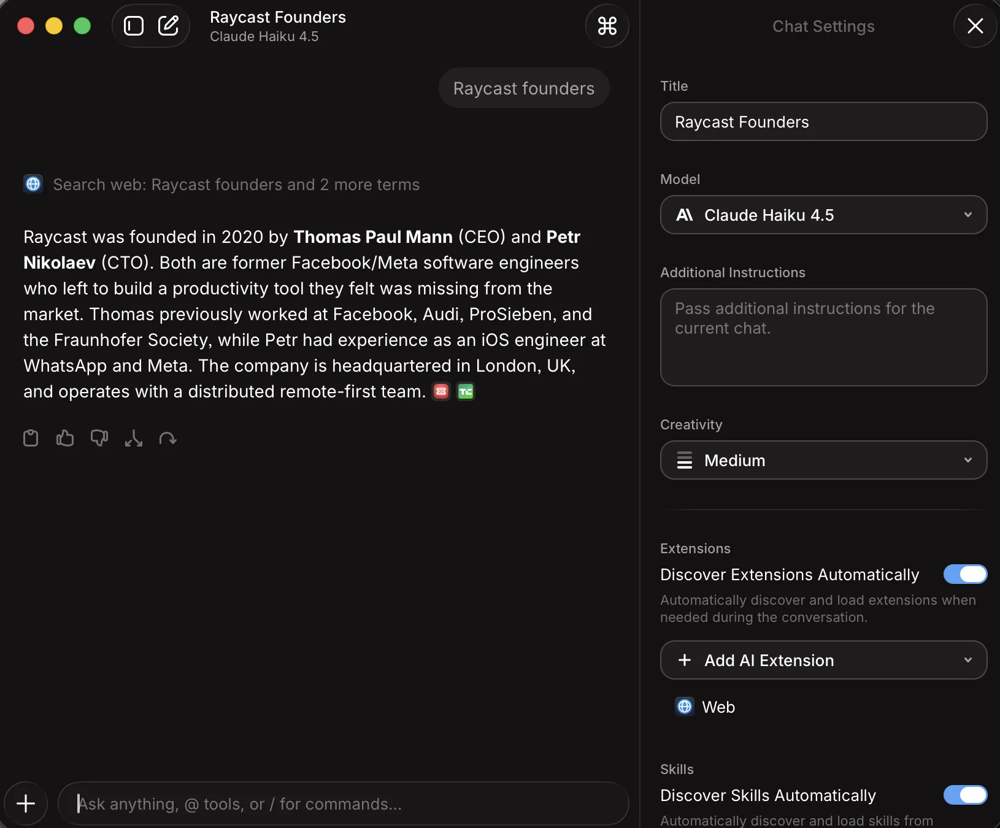
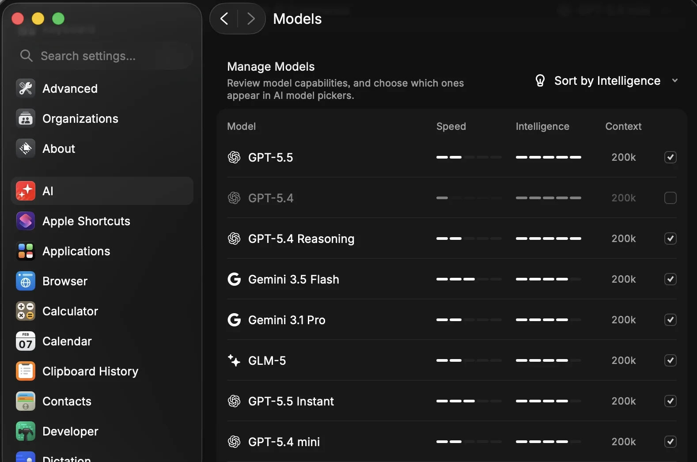
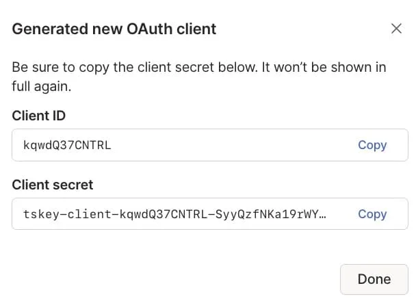
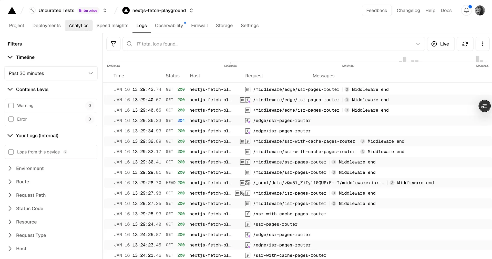
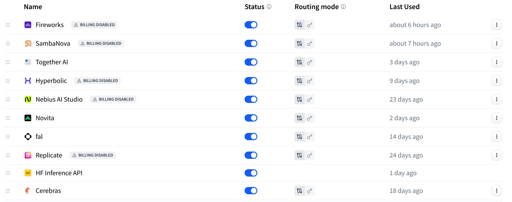
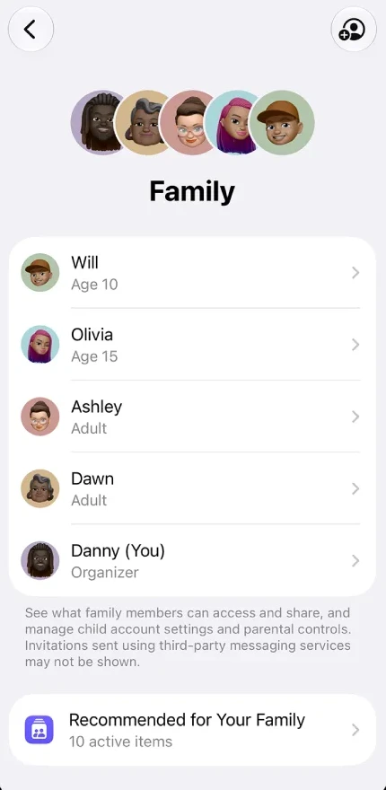
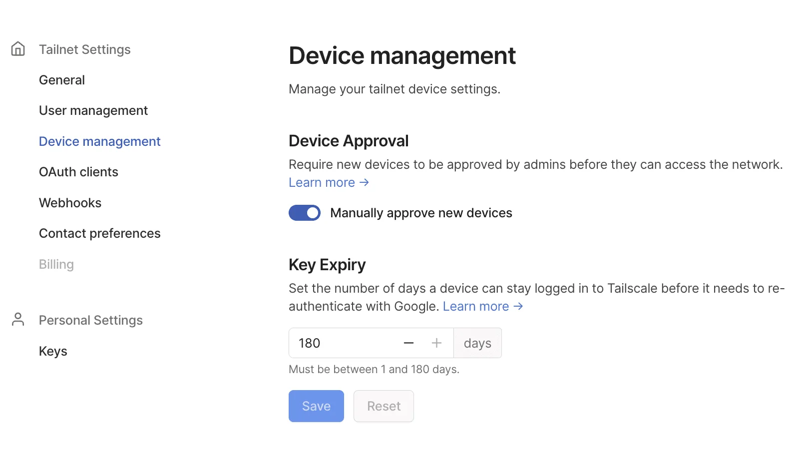

# Azizam benchmark board

This board is the scoring set for Azizam's UI. Each Azizam surface has 2 or 3 shipped screens from best-in-class products that do the **same job**. A judge puts an Azizam screenshot next to the benchmark and checks the numbered traits. The question is: "does Azizam do this job at least as well as this named real product?"

It replaces `../references/board.md` as the bar. That board stays useful for patterns, but most of its references (status-page vendors, Home Assistant, Grafana, Uptime Kuma) are below the league Tim asked for ("on par with stripe vercel linear plaid etc.").

## How to use it

- Compare like with like: desktop Azizam at 1440 × 900 against `-desktop` files, and phone Azizam at 390 × 844 against `-phone` files. Live captures use DPR 1, the same as Azizam's own harness (`../references/anti/*-390.webp`).
- **[observed]** means you can see the trait in the benchmark image. **[inferred]** means it comes from docs text or product knowledge and is not visible in the pixels. Weight observed traits higher.
- A trait is a pass/fail check on the **Azizam** screenshot. "About" numbers are estimates read from the benchmark image, not CSS measurements.
- Docs screenshots and App Store shots are real product UI, but they are staged with seeded data and are often cropped or framed. Judge their composition and copy, not their exact size.
- All captures were made on 2026-10-08 (UTC; the evening of 2026-10-07 US time) in a fresh headless Chromium context with no login, using `capture.cjs`. Per-file source URLs are in `capture-log/<surface>.jsonl`. Images over 2400 px wide were scaled down to 2400 px.
- Kind: **live** = a public page captured by us. **docs** = an official docs screenshot. **official shot** = official marketing or App Store imagery of the real UI.

Totals: 13 surfaces, 38 benchmark entries, 66 WebP files.

**v2 (2026-10-08):** blind calibration judges rejected 22 images as marketing heroes, download or docs pages, public share pages, device frames, redaction bars, annotations or clipped renders. They are in `_retired/` (reasons in NOTES.md). Their replacements are real logged-in app screenshots from official docs and support pages (Apple Support, Raycast manual, Tailscale KB, Hugging Face docs, Vercel docs), cropped to the app window.

---

## 1. Home (member landing)
Azizam job: tell a member what they can do, whether it is ready, and how to connect an app.

### 1a. Apple Home — "My Home" (iPhone)

Source: https://www.apple.com/home-app/ (image `homeapp_startframe`) · Kind: official shot
Job: a household landing page with a status summary first, then the things you can act on.
Why: this is the most widely used household app for non-technical people. It shares Azizam's audience and its "one home, many members" model.
Traits:
1. The title is one noun phrase ("My Home") with no helper sentence. [observed]
2. A chip row under the title gives readiness at a glance. Each chip is a category plus a value of 3 words or fewer ("Lights 3 On", "Security 1 Unlocked"). [observed]
3. Sections are named nouns with a chevron (Cameras, Scenes, Entry). The first section shows live content, not a count. [observed]
4. Each actionable tile shows an icon, a name of 1–2 words, and its state. State is shown by both fill and a word ("On", "Off"). [observed]
5. "+" (add) is in the top bar, one tap from the landing. [observed]

### 1b. Stripe Dashboard iOS — Home "Today"

Source: https://apps.apple.com/us/app/stripe-dashboard/id978516833 (screenshot 1) · Kind: official shot (App Store composite; judge the front phone only)
Job: the landing that answers "how is it going today?" before any navigation.
Why: Stripe is a named bar. Its home leads with a verdict in numbers and puts creation one tap away.
Traits:
1. The first block is "Today" with 3 numbers (Gross volume, Payments, Customers). Each is a label of 1–2 words over one number. [observed]
2. A filled "+" create action is at top right, in the first viewport. [observed]
3. Change against the prior period is shown as a signed percentage in green ("+8.3%") next to the comparison figure. [observed]
4. The range picker is one segmented row (1W 4W 1Y MTD QTD YTD ALL) with one selected. [observed]
5. The section can be edited by the user ("Edit" link on "Reports overview"). [observed]

**Gap:** we found no public pixels of a best-in-class **desktop** member home that combines "what can I do" with "connect your first client". 
**Anti-benchmark:** Home Assistant's demo dashboard (`../references/public/home-assistant-desktop.webp`) repeats the same card grammar for every item and has no single readiness verdict.

---

## 2. Status
Azizam job: say whether the gateway works, what is broken, who is affected, and what to do. Tim's test: a member can tell a gateway problem from a key, model or workflow problem.

### 2a. Linear status — healthy
 · phone: 
Source: https://linearstatus.com · Kind: live (incident.io-hosted, Linear brand)
Job: give a verdict first, then show health per component.
Why: Linear is the named bar, and incident.io is the current best-designed status-page product.
Traits:
1. The verdict banner is the first content block. It is one sentence of 5 words or fewer ("We're fully operational") plus at most one detail line. [observed]
2. State is carried by both an icon and colour, so it reads without the text. [observed]
3. Each component row shows its name, a state icon and an uptime % on one line, with no hover. [observed]
4. Components are named by what users use (Application, API, Integrations), not by internal services. [observed]
5. The header has exactly two actions ("Report a problem", "Subscribe to updates"). [observed]

### 2b. Linear status — incident detail (failure)
 · phone: 
Source: https://linearstatus.com/incidents/9ews8tnv · Kind: live (past incident)
Job: show a failure with its scope, its severity and a timeline of updates.
Traits:
1. The title names the symptom in user words ("Some customers are seeing issues with Linear loading"), with no error code. [observed]
2. Status and severity appear as two words on one line under the title ("Resolved · Partial outage"). [observed]
3. A separate "Affected components" block names the broken part and shows the outage window on a time bar. [observed]
4. Updates are a timeline, newest first. Each update has a state word (Investigating → Monitoring → Resolved) and an absolute time. [observed]
5. Cause and fix are given in 1–2 plain sentences. [observed]

### 2c. incident.io — incident with affected and unaffected users
 · phone: 
Source: https://status.incident.io/incidents/4ztahb1z · Kind: live (past incident)
Job: say who is affected and who is not, whose fault it is, and whether the reader must act.
Traits:
1. The resolution states the reader's next action explicitly, even when that action is "none" ("no further action is required"). [observed]
2. Scope is split into who is affected and who is not ("Customers using SAML sign-in aren't affected"). [observed]
3. The origin of the fault is named, and an upstream vendor fault is kept separate from the product's own fault. This maps to Azizam's gateway / provider / model layers. [observed]
4. Healthy, incident and resolved states use the same layout. [observed]

### 2d. Apple System Status — consumer verdict (phone)
 · desktop: 
Source: https://www.apple.com/support/systemstatus/ · Kind: live
Job: a status verdict for non-technical people.
Traits:
1. At 390 px the whole answer is one sentence with a green dot ("All services are operating normally."), above the fold. [observed]
2. Services that are not broken are folded behind one "+" control on phone. [observed]
3. There is one escape route for unlisted problems ("contact support"). [observed]
4. "Last updated" is shown with a time and time zone. [observed]
5. On desktop, every service uses its consumer name, one row each, with the dot on the left. [observed]

**Anti-benchmarks:** the old board's GitHub, OpenAI and Vercel status pages repeat "operational" 3 or more times per screen. Apple's desktop list has 70+ equal rows, which is fine for consumers and useless to an owner. None of these says who is affected.

---

## 3. Library
Azizam job: let members browse, find and play what the household made (images, audio, video), with who, when and what visible.

### 3a. Midjourney — Explore grid
 · phone: 
Source: https://www.midjourney.com/explore · Kind: live (public, logged out)
Job: scan many generated images at once.
Why: designers treat it as the reference gallery for generated media.
Traits:
1. Tiles keep their native aspect ratio (masonry), with no square crop. [observed]
2. Gutters between tiles are about 2 px, and tiles have no per-tile text or card chrome. [observed]
3. Media type (Images/Videos) and sort ("Top day") are two controls in one row above the grid. [observed]
4. Phone: 2 columns, the grid starts within about 70 px of the top, and navigation is a bottom tab bar of 4 or fewer items. [observed]
5. The create field stays visible (a bottom bar on phone). [observed]

### 3b. Apple Photos — library grid (iPhone), item viewer and Info panel (Mac)
 · viewer:  · info: 
Source: https://support.apple.com/guide/iphone/browse-your-photo-library-iph7d24753a5/ios · https://support.apple.com/guide/photos/view-photos-and-videos-pht8b9ba4aa9/mac · https://support.apple.com/guide/photos/see-photo-and-video-information-phta8b25fa42/mac · Kind: docs (Apple Support screenshots of the real apps; device frame and callouts cropped away)
Job: a household's own media library: scan the grid on a phone, open one item, see who/when/where/with what.
Why: the most-used personal media library, shown in its logged-in, populated state. It replaces Suno's public share pages.
Traits:
1. Phone grid: 3 columns of square tiles, 1–2 px gutters, no per-tile text. A favourite shows only as a small heart badge on the tile. [observed]
2. Phone: the large "Library" title and the date of the visible items ("Jul 13, 2025") float over the grid; "Select" and a filter button sit top right. There is no separate app bar. [observed]
3. Phone: one floating bottom pill holds the zoom level as a segmented control (Years / Months / All), with search as a round button beside it, in thumb reach. [observed]
4. Viewer: one centred meta line under the title gives place, exact time and position ("Los Angeles - Mar Vista · December 16, 2025 at 5:40:00 PM · 1,918 of 2,147"). [observed]
5. Viewer: back at left; favourite, share and a text "Edit" at right; the library sidebar stays visible (Library, Pinned, Albums, Shared Albums). [observed]
6. Info panel: provenance is a stack of short blocks separated by hairlines: title, filename, date with an "Adjust" link, device and settings ("Apple iPhone 16 Pro / Main Camera — 24 mm ƒ1.78"), caption, keywords, people, place. For Azizam: who, when, model, prompt. [observed]
7. Info panel: empty fields are shown as grey editable placeholders ("Add a Caption", "Add a Keyword"), not hidden. [observed]

### 3c. Apple Music (audio list)
 · phone: 
Source: https://music.apple.com/us/album/abbey-road-remastered/1441164426 · Kind: live
Job: an audio list with play.
Traits:
1. Audio row: index, title, right-aligned duration and an overflow menu. Row height is about 46 px. [observed]
2. One large play button sits next to the title block, and a mini-player floats over the list. [observed]

**Gap:** we found no logged-in mixed-media library (image, audio and video in one list), and no logged-in library of *generated* media with prompt and model on the item (Midjourney's Organize docs were behind a Cloudflare challenge). Midjourney Explore (3a) is a public page; judge only its grid. **Anti-benchmark:** Apple Music's web view on phone loses content height to an "open the app" banner.

---

## 4. Try (playground)
Azizam job: pick a model or workflow, enter input, run it, and see the result with time and cost.

### 4a. Raycast — AI Chat with chat settings

Source: https://manual.raycast.com/ai/ai-chat · Kind: docs (official app screenshot, cropped to the window)
Job: pick a model, ask, and see a finished answer with its steps and follow-up actions.
Why: a design-led native app whose chat sits on top of many providers, as Azizam's does.
Traits:
1. The model is named under the chat title ("Claude Haiku 4.5") and is changed in one select in the side panel. [observed]
2. A finished run shows the tool step as one grey line ("Search web: Raycast founders and 2 more terms") above the answer, and sources as small chips at the end of the answer. [observed]
3. Under the answer is one row of 5 icon actions (copy, good, bad, branch, retry), with no labels. [observed]
4. The composer is one line at the bottom ("Ask anything, @ tools, or / for commands..."), with "+" at its left. [observed]
5. Run settings are a side panel of labelled controls (Title, Model, Additional Instructions, Creativity "Medium", toggles with one grey helper line each), not a modal. [observed]
6. Anti-trait: no time, tokens or cost after the run. Azizam should show them. [observed absence]

### 4b. Vercel AI SDK Playground — model compare; OpenRouter chat
 · phone:  · also:  · 
Source: https://ai-sdk.dev/playground · https://openrouter.ai/chat · Kind: live
Job: pick models and chat side by side, with prices shown before running.
Traits:
1. The model picker is at the top left of each pane, with a provider icon. [observed]
2. An empty pane shows a model card (description, context, input and output price per million tokens) instead of being blank. [observed]
3. The composer is one line at the bottom of the pane. On phone it stays within the bottom 100 px. [observed: OpenRouter phone]
4. Starter prompts are offered as chips above the composer. [observed: OpenRouter]

**Gap:** no real-app screenshot shows a finished run with cost and latency together (Anthropic Workbench, OpenAI Playground, Vercel and Cloudflare playground docs have no screenshots; Hugging Face's playground image is empty). No phone playground from a logged-in app was found. **Anti-benchmark:** fal.ai's playground shows a grey "Idle" result box, and an announcement pop-up covered the form on every capture.

---

## 5. Models & Workflows catalog
Azizam job: show what the gateway can do and which model fits which job, with price and speed.

### 5a. Raycast — Settings > AI > Manage Models

Source: https://manual.raycast.com/ai/ai-chat · Kind: docs (official app screenshot, cropped to the window)
Job: see what each model is good at and choose which ones members can pick.
Traits:
1. One sentence says what the screen is for ("Review model capabilities, and choose which ones appear in AI model pickers."). [observed]
2. Columns are Model, Speed, Intelligence, Context. Speed and intelligence are 5-segment bars, so models compare at a glance without numbers; context is a number ("200k"). [observed]
3. One sort control at top right ("Sort by Intelligence"). [observed]
4. Each row ends in a checkbox. A model that is turned off stays in the list, greyed, so it can be turned back on. [observed]
5. Each row starts with the vendor logo, then the model name; there is no description text. [observed]
6. Anti-trait: no price column. Azizam should add cost. [observed absence]

### 5b. OpenRouter — model list
 · phone: 
Source: https://openrouter.ai/models · Kind: live
Traits:
1. A list row has the name, a 2-line description, vendor, date, context and price in and out. [observed]
2. Category tabs show counts (for example "Text 467"). [observed]

**Gap:** no in-app catalog with price **and** speed in one row (Vercel's dashboard Models tab and Cloudflare's model list have no docs screenshots). **Anti-benchmark:** Replicate /explore and the public Vercel AI Gateway models page are marketing-led.

---

## 6. Apps & API keys
Azizam job: create a key, show it once, and connect a named client.

### 6a. Tailscale — "Generated new OAuth client" (shown once)

Source: https://tailscale.com/kb/1215/oauth-clients · Kind: docs (admin console dialog; the source is only 608 px wide)
Traits:
1. The title names the object ("Generated new OAuth client"). [observed]
2. The shown-once warning is the first line, one sentence of 15 words or fewer ("Be sure to copy the client secret below. It won't be shown in full again."), not a separate alert. [observed]
3. Each value is a read-only boxed field in monospace with its own "Copy" text button inside the right edge. [observed]
4. The secret keeps a readable prefix (`tskey-client-…`) and is truncated with "…". [observed]
5. One exit: "Done" at bottom right, plus a close X. [observed]

### 6b. Resend — API keys list

Source: https://resend.com/docs/dashboard/api-keys/introduction · Kind: docs
Why: Resend is widely praised as a Linear/Vercel-grade developer dashboard.
Traits:
1. One primary "Create API Key" button at top right, and no helper paragraph above the table. [observed]
2. A row shows name, a token prefix of about 10 characters plus "…", permission, last used and created, with no hover. [observed]
3. "Last used" is relative ("Never", "16 days ago"). A stale key gets a warning icon. [observed]
4. Row actions are collapsed into one "…" menu. [observed]

**Gap:** no real-app screenshot of "connect a named client" (a key plus a ready-to-paste recipe per client) was found. Vercel AI Gateway, Stripe, OpenAI, Anthropic, GitHub and Supabase docs serve no usable key-creation pixels. Azizam sets this bar itself.
**Note:** Stripe's documented rule (user-created keys are shown once; rotation keeps the old key valid for up to 7 days) is in divan `product-design/stripe-lets-you-re-reveal-only-keys…`. Its docs images are icons, so there are no Stripe pixels for this job.

---

## 7. Usage & Activity
Azizam job: show spend, requests, a per-request receipt, and failures.

### 7a. Vercel — AI Gateway usage charts and project request log
 · request log: 
Source: https://vercel.com/docs/ai-gateway/observability · https://vercel.com/docs/logs/runtime · Kind: docs
Why: the closest same-job product (an AI gateway), with Geist craft.
Traits:
1. Each chart card has a title, then one headline number ($232.36, 1.15s, 4.5K, 266M), then the chart. [observed]
2. The usage page has two controls: environment and time window. [observed]
3. The incomplete current interval is drawn dotted. [observed]
4. Log: a left filter rail leads with time window ("Past 30 minutes") and level counts ("Warning 0", "Error 0"), so "any failures?" is answered before reading rows. [observed]
5. Log: the search field states the count ("17 total logs found…") and sits next to "Live" and refresh. A small histogram of requests over time sits above the table. [observed]
6. Log rows: monospace time to 1/100 s, method, coloured status code (200 green, 304 blue), host, path and a message, all on one ~40 px line. [observed]

### 7b. Stripe Workbench — request log and errors
 · errors: 
Source: https://docs.stripe.com/workbench/overview · Kind: docs
Traits:
1. A row shows a status chip (200/400), method, path and time, with no hover. [observed]
2. Selecting a row opens the receipt beside the list (split view), without a page change. [observed]
3. The receipt starts with the request ID and a copy icon, then label/value rows (time, IP, source, API version). [observed]
4. Errors are grouped by cause with a count, and the detail starts with one human sentence of reason. [observed]
5. An "Impact" block gives occurrences over 7 days and the source, and the failing request body sits beside it. [observed]

### 7c. Resend — log detail; OpenRouter — activity
 · 
Source: https://resend.com/features/email-api (official shot) · https://openrouter.ai/docs/guides/features/activity (docs)
Traits:
1. Receipt title is "POST /emails", not an ID. Its facts sit in a label-over-value grid (endpoint, age, status, method, user agent). [observed]
2. The response body comes before the request body, both in monospace. [observed]
3. Activity: a row of 5 KPI tiles, each with a label, a number and a sparkline. [observed]
4. Top keys and top apps are ranked lists with right-aligned counts. [observed]

**Gap:** no real-app receipt shows **cost per request** next to status, and no unredacted Vercel per-key spend table exists (the by-key and by-project images were retired for redaction bars). Failures are shown only by Stripe Workbench (7b).

---

## 8. Engines & Providers (owner)
Azizam job: the owner sees each backend with its health, connects credentials, and sets caps.

### 8a. Raycast — Settings > AI: models and providers
 · custom providers: 
Source: https://manual.raycast.com/ai/bring-your-own-subscription · https://manual.raycast.com/ai/custom-providers · Kind: docs (official)
Why: a Mac-native, design-led product that has the same model as Azizam: local backends (Ollama, LM Studio, LiteLLM), subscriptions and API keys in one list.
Traits:
1. Each provider is one row: logo, name, then actions (delete, open, toggle) on the right, with no hover. [observed]
2. A connected account shows a green dot plus its identity and plan ("jac@raycast.com (Claude Max)"). [observed]
3. Each group has one cost sentence of 12 words or fewer ("You'll pay each provider's standard rates.") and a "+" add button. [observed]
4. Local backends get one row each with a right-aligned "N models" count. [observed: custom providers]
5. The default model per use is a right-aligned select on the row ("AI Chat → Last Used Model"). [observed]

### 8b. Hugging Face — Inference Providers (account settings)
 · health columns: 
Source: https://huggingface.co/docs/inference-providers/hub-integration (app screenshot) · https://openrouter.ai/anthropic/claude-sonnet-4.5/providers (live, desktop only) · Kind: docs + live
Job: the owner sees every backend, which are on, how each is paid for, which need attention, and when each was last used.
Traits:
1. One row per provider: drag handle, logo and name, an on/off toggle, a routing-mode control, "Last Used" and a "⋮" menu. [observed]
2. A provider that needs attention carries a word chip beside its name ("⚠ BILLING DISABLED"), not colour alone; 5 of 10 rows show it while staying in the list. [observed]
3. Routing mode is a 2-segment icon control per row (route through the platform vs use your own key). For Azizam: gateway key vs owner's provider key. [observed]
4. "Last Used" is relative ("about 6 hours ago", "24 days ago"). [observed]
5. Order is user-set by drag, which sets fallback priority. [inferred from handle]
6. OpenRouter (secondary): one row per backend with price, latency, throughput and uptime % plus a small bar; numeric columns right-aligned. [observed]

### 8c. Vercel — Spend Management (cap)

Source: https://vercel.com/docs/spend-management · Kind: docs
Traits:
1. Use against the cap is one string ("$359 / 300 (100%)") plus a ring gauge. [observed]
2. The state is named in words under the figure ("Spend Management Enabled"), with one toggle. [observed]
3. Over the cap, the gauge turns red. [observed]
4. Save is disabled until something changes. [observed]

**Gap:** Hugging Face shows a warning state but no fix action and no health or latency; no owner console shows **health per backend with an error state and a fix** in one view. **Anti-benchmark:** Vercel shows 100% of the cap in red but offers no next action beyond "Manage".

---

## 9. People, invites & access plans
Azizam job: the owner invites household members, chooses what they can use and spend, and sees who has joined and who is pending.

### 9a. Apple Family Sharing — Family (iPhone)

Source: https://support.apple.com/guide/iphone/set-up-family-sharing-iph33a7f1b0f/ios · Kind: docs (Apple Support screenshot; device frame cropped away)
Job: one household, its members and their roles, on a phone.
Why: the same audience and model as Azizam (an organiser, adults and children in one household).
Traits:
1. A row of member avatars over a one-word title ("Family"). [observed]
2. One rounded card lists all members. Each row: avatar, name, one grey role line (Age 10, Adult, Organizer) and a chevron. [observed]
3. The current user is tagged in the name ("Danny (You)"). [observed]
4. Add-member is one icon button at top right; back is at top left. There is no other chrome. [observed]
5. One grey footnote under the card says what the screen controls and a known limit of invites. [observed]
6. Anti-trait: pending invitations are not visible in the list. Azizam should show pending members. [observed absence]

### 9b. Vercel — invite and role picker

Source: https://vercel.com/docs/rbac/managing-team-members · Kind: docs
Traits:
1. Every role option has a plain consequence of 8 words or fewer ("Read-only access to a team"). [observed]
2. Email and role are in one row, and "Add more" allows a batch invite. [observed]
3. One primary "Invite" button, with "Invite Link" as the secondary route. [observed]
4. The optional narrowing step ("Assign Project Roles") stays disabled until it applies. [observed]
5. Contrast: Tailscale's invite dialog (`people/tailscale-invite-roles-desktop.webp`, https://tailscale.com/kb/1064/invite-team-members) says what the invitee receives in the dialog body, but lists 6 bare role names with no consequence line. Azizam should follow Vercel. [observed]

### 9c. Linear — team permissions

Source: https://linear.app/docs/members-roles · Kind: docs
Traits:
1. Each permission is named as a capability, with a "Who can…" helper line. [observed]
2. The choice is between 2 plain options ("All team members" / "Only team owners"). [observed]
3. It uses the same row anatomy as Settings (10a), so there is no new pattern to learn. [observed]

---

## 10. Settings
Azizam job: owner and member find a setting fast and change it, with the current value always visible.

### 10a. Linear — settings detail

Source: https://linear.app/docs/account-preferences · Kind: docs
Traits:
1. A row is a label, one grey helper line, and a control on the right that shows its current value. [observed]
2. Rows sit in titled cards. [observed]
3. There is no Save button; changes apply in place. [inferred]

### 10b. Tailscale — admin console, Tailnet Settings > Device management

Source: https://tailscale.com/kb/1099/device-approval · Kind: docs (admin console screenshot)
Job: find an owner setting in a grouped index and change it with its current value visible.
Traits:
1. The sidebar has two groups with an icon and a muted group label ("Tailnet Settings", "Personal Settings"). Items are 1–2 words; the selected item is blue text, with no fill. An unavailable item (Billing) is greyed, not hidden. [observed]
2. The page has a large title and one grey helper line ("Manage your tailnet device settings."). [observed]
3. Each setting is a titled section with one plain sentence of consequence and a "Learn more →" link. [observed]
4. Controls show their current value: a toggle with its label ("Manually approve new devices"), a stepper with a unit ("180 days") and its valid range under it. [observed]
5. Save and Reset stay disabled until something changes. [observed]

### 10c. Raycast — settings window
 · also 8a
Source: https://manual.raycast.com/settings · Kind: docs
Traits:
1. The account is the first sidebar item, with a name and a subtitle. [observed]
2. Subscription state is a word in green ("Active"). [observed]
3. A "Search settings…" field sits above the sidebar. [observed: 8a]
4. "Sign Out" is red text at the bottom. [observed]

---

## 11. Sign-in, invite acceptance, first-run setup
Azizam job: get a household member from an invite link to signed in, on a phone, with as few choices as possible. Get the owner through first-run setup.

### 11a. Linear — log in
 · phone: 
Source: https://linear.app/login · Kind: live
Traits:
1. One heading ("Log in to Linear") and no marketing copy. [observed]
2. At most 4 sign-in buttons. One is filled; the rest are outlined. [observed]
3. The screen has 12 words of body text or fewer, not counting button labels. [observed]
4. At 390 px the whole form fits with no scroll. [observed]
5. Sign-up is one text link. [observed]

### 11b. Vercel — log in
 · phone: 
Source: https://vercel.com/login · Kind: live
Traits:
1. The email field and a dark "Continue with Email" are the first two controls. [observed]
2. Other providers are outlined buttons below a divider, and rare options sit behind "Show other options". [observed]
3. Phone: the whole form is in the first viewport. [observed] (A Google one-tap sheet overlaps it; that is third-party UI.)

### 11c. Discord — invite landing (invitee view)

Source: https://discord.com/invite/python · Kind: live (desktop only; the phone render was blank)
Why: a mainstream, non-technical invite acceptance page that is public with no login. No best-in-class B2B product exposes one.
Traits:
1. "You've been invited to join" plus the target name, in larger type, above any field. [observed]
2. One line of context under the name (online and member counts). For Azizam: who invited you. [observed]
3. One filled primary button. The existing-account route is one text link. [observed]
4. Anti-trait: it asks for a date of birth. Azizam should ask only for a name, or nothing. [observed]

### 11d. Home Assistant — first-run "Create user" (category floor, not the league)

Source: https://www.home-assistant.io/getting-started/onboarding/ · Kind: docs
Why: we found no public pixels of a best-in-class first-run setup. This is the closest self-hosted household peer, so use it as the **floor**: Azizam must at least match it.
Traits:
1. One title and one intro sentence of 9 words or fewer. [observed]
2. 4 fields, all labelled. [observed]
3. The primary button stays disabled until the form is valid. [observed]
4. Language and help are in the footer, not in the form. [observed]

---

## 12. Empty and error states
Azizam job: say what is empty and what to do next, name the failing layer (gateway, key, model, workflow) and the fix, and handle not-found.

### 12a. Stripe — 404
 · phone: 
Source: https://stripe.com/this-does-not-exist · Kind: live
Traits:
1. A headline of 3 words or fewer ("Page not found"). [observed]
2. One sentence of 15 words or fewer, plus a home link. [observed]
3. Instead of a dead end, it offers destinations, each with a title and a one-line purpose. [observed]
4. "System status" is offered as one of the exits. [observed]

### 12b. Vercel — failed build: row state and log cause
 · log: 
Source: https://vercel.com/docs/deployments/troubleshoot-a-build · Kind: docs
Traits:
1. The failed row has a red dot, the word "Error" and a duration, so the state is not shown by colour alone. [observed]
2. The log puts the cause on one line starting with "Error:" and names the failing unit. [observed]
3. The fix is a "Read more:" link to a specific docs page. [observed]

### 12c. Vercel Geist — Error and Empty State rules
 ·  · phones:  
Source: https://vercel.com/geist/error · https://vercel.com/geist/empty-state · Kind: live (design system)
Traits:
1. An inline error is one sentence with an icon, and can carry a label prefix that names the source ("Email Error:"). For Azizam: "Gateway:", "Key:", "Model:". [observed]
2. Empty states come in four types by intent: Blank Slate, Informational (inline CTA plus docs link), Educational and Guide. A first-run empty state must include an inline CTA. [observed: rules]

### 12d. OpenRouter — first-run chat and no-results
 · phone:  · no results:  · phone: 
Source: https://openrouter.ai/chat · https://openrouter.ai/models?q=zzqxv · Kind: live
Traits:
1. The empty chat is filled with starter cards and prompt chips, so the next action is visible. [observed]
2. With no results, every tab shows its count as 0, so the user sees the search caused the empty view. [observed]
3. Anti-trait: "No matching models found for your search." offers no "Clear search" action. Azizam's empty state must name one. [observed]

**Gap:** we found no flagship screen that names the failing **layer** and the fix in one view. Azizam has to set this bar itself (playbook G4). **Anti-benchmark:** the default Next.js 404 ("This page could not be found.") offers no exit.

---

## 13. Phone layouts
Azizam job: member surfaces at 390 px, with a list that shows status, the primary action in thumb reach, and a detail view.

### 13a. Things 3 (iPhone)
 · 
Source: https://apps.apple.com/us/app/things-3/id904237743 · Kind: official shot
Why: two Apple Design Awards (see divan `product-design/things3-partitions…`). It is the usual example of calm list design.
Traits:
1. List rows are about 44 pt tall: icon, title, and a right-aligned count. [observed]
2. A badge appears only where action is needed. [observed]
3. A round "+" primary button is at bottom right, in thumb reach. [observed]
4. A row subtitle gives context in grey (the project name). [observed]
5. Search is a visible field at the top ("Quick Find"), not just an icon. [observed]

### 13b. Stripe Dashboard iOS — detail
 · home: 
Source: https://apps.apple.com/us/app/stripe-dashboard/id978516833 · Kind: official shot
Traits:
1. Detail view: a back chevron and a centred title. [observed]
2. Status is a coloured word next to the amount ("succeeded", "Active"). [observed]
3. The primary action is a full-width filled button at the bottom ("Copy link"), with "…" next to it. [observed]
4. Detail rows put the label on the left and the value on the right. [observed]

### 13c. Other phone screens on this board
Apple Photos library (3b), Apple Family Sharing (9a), Apple System Status (2d), Midjourney (3a), OpenRouter models (5b), Linear login (11a). Common traits to check:
1. The verdict or primary action is inside the first 844 px. [observed in 2d, 9a, 11a]
2. No horizontal scroll, except deliberate table scroll. [observed]
3. Persistent controls (bottom pill, composer, bottom bar) are within the bottom 100 px. [observed in 3a, 3b, 4b]
