# Azizam benchmark board

This board is the scoring set for Azizam's UI. Each Azizam surface has 2 or 3 shipped screens from best-in-class products that do the **same job**. A judge puts an Azizam screenshot next to the benchmark and checks the numbered traits. The question is: "does Azizam do this job at least as well as this named real product?"

It replaces `../references/board.md` as the bar. That board stays useful for patterns, but most of its references (status-page vendors, Home Assistant, Grafana, Uptime Kuma) are below the league Tim asked for ("on par with stripe vercel linear plaid etc.").

## How to use it

- Compare like with like: desktop Azizam at 1440 × 900 against `-desktop` files, and phone Azizam at 390 × 844 against `-phone` files. Live captures use DPR 1, the same as Azizam's own harness (`../references/anti/*-390.webp`).
- **[observed]** means you can see the trait in the benchmark image. **[inferred]** means it comes from docs text or product knowledge and is not visible in the pixels. Weight observed traits higher.
- A trait is a pass/fail check on the **Azizam** screenshot. "About" numbers are estimates read from the benchmark image, not CSS measurements.
- Docs screenshots and App Store shots are real product UI, but they are staged with seeded data and are often cropped or framed. Judge their composition and copy, not their exact size.
- All captures were made on 2026-10-08 (UTC; the evening of 2026-10-07 US time) in a fresh headless Chromium context with no login, using `capture.cjs`. Per-file source URLs are in `capture-log/<surface>.jsonl`. Images over 2400 px wide were scaled down to 2400 px.
- Kind: **live** = a public page captured by us. **docs** = an official docs screenshot. **official shot** = official marketing or App Store imagery of the real UI.

Totals: 13 surfaces, 41 benchmark screens, 77 WebP files.

---

## 1. Home (member landing)
Azizam job: tell a member what they can do, whether it is ready, and how to connect an app.

### 1a. Apple Home — "My Home" (iPhone)
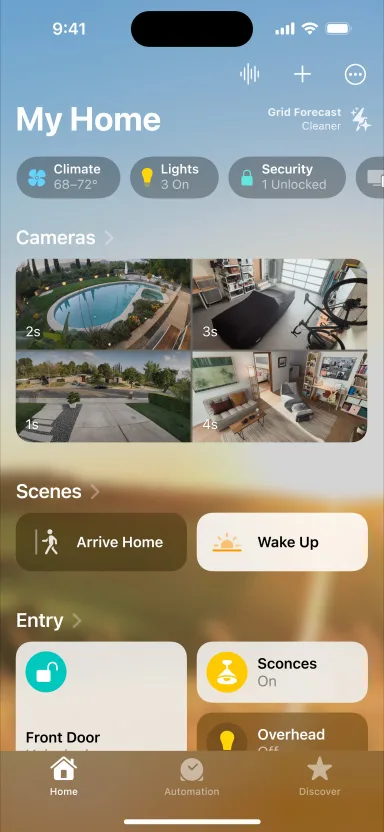
Source: https://www.apple.com/home-app/ (image `homeapp_startframe`) · Kind: official shot
Job: a household landing page with a status summary first, then the things you can act on.
Why: this is the most widely used household app for non-technical people. It shares Azizam's audience and its "one home, many members" model.
Traits:
1. The title is one noun phrase ("My Home") with no helper sentence. [observed]
2. A chip row under the title gives readiness at a glance. Each chip is a category plus a value of 3 words or fewer ("Lights 3 On", "Security 1 Unlocked"). [observed]
3. Sections are named nouns with a chevron (Cameras, Scenes, Entry). The first section shows live content, not a count. [observed]
4. Each actionable tile shows an icon, a name of 1–2 words, and its state. State is shown by both fill and a word ("On", "Off"). [observed]
5. "+" (add) is in the top bar, one tap from the landing. [observed]

### 1b. Stripe Dashboard iOS — Home "Today"
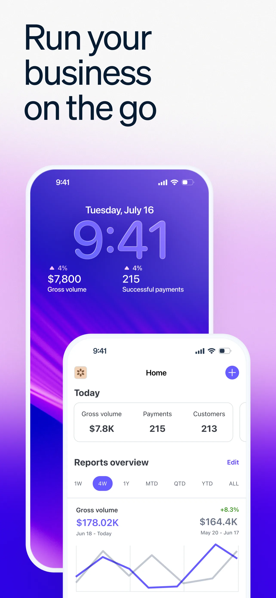
Source: https://apps.apple.com/us/app/stripe-dashboard/id978516833 (screenshot 1) · Kind: official shot (App Store composite; judge the front phone only)
Job: the landing that answers "how is it going today?" before any navigation.
Why: Stripe is a named bar. Its home leads with a verdict in numbers and puts creation one tap away.
Traits:
1. The first block is "Today" with 3 numbers (Gross volume, Payments, Customers). Each is a label of 1–2 words over one number. [observed]
2. A filled "+" create action is at top right, in the first viewport. [observed]
3. Change against the prior period is shown as a signed percentage in green ("+8.3%") next to the comparison figure. [observed]
4. The range picker is one segmented row (1W 4W 1Y MTD QTD YTD ALL) with one selected. [observed]
5. The section can be edited by the user ("Edit" link on "Reports overview"). [observed]

**Gap:** we found no public pixels of a best-in-class **desktop** member home that combines "what can I do" with "connect your first client". The closest same-category screen is the Vercel AI Gateway getting-started page (5c), which is a docs page.
**Anti-benchmark:** Home Assistant's demo dashboard (`../references/public/home-assistant-desktop.webp`) repeats the same card grammar for every item and has no single readiness verdict.

---

## 2. Status
Azizam job: say whether the gateway works, what is broken, who is affected, and what to do. Tim's test: a member can tell a gateway problem from a key, model or workflow problem.

### 2a. Linear status — healthy
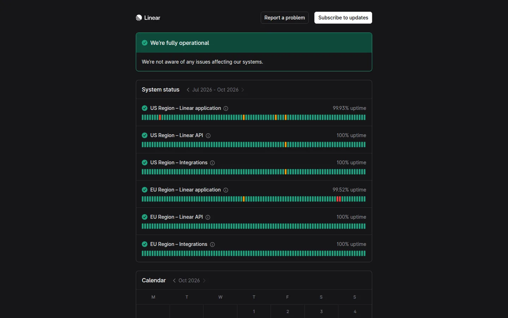 · phone: 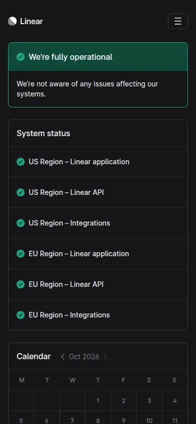
Source: https://linearstatus.com · Kind: live (incident.io-hosted, Linear brand)
Job: give a verdict first, then show health per component.
Why: Linear is the named bar, and incident.io is the current best-designed status-page product.
Traits:
1. The verdict banner is the first content block. It is one sentence of 5 words or fewer ("We're fully operational") plus at most one detail line. [observed]
2. State is carried by both an icon and colour, so it reads without the text. [observed]
3. Each component row shows its name, a state icon and an uptime % on one line, with no hover. [observed]
4. Components are named by what users use (Application, API, Integrations), not by internal services. [observed]
5. The header has exactly two actions ("Report a problem", "Subscribe to updates"). [observed]

### 2b. Linear status — incident detail (failure)
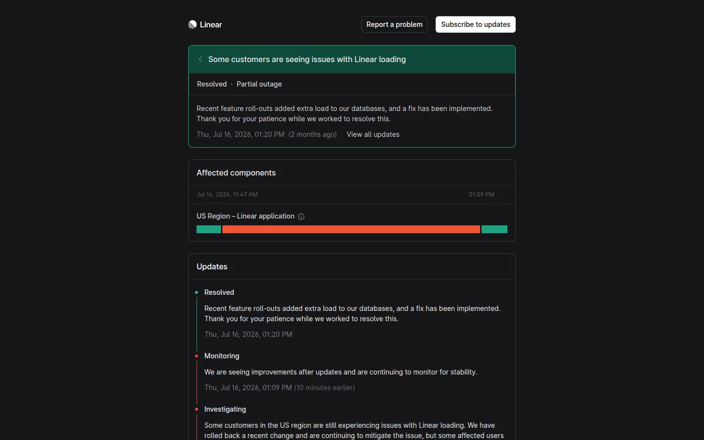 · phone: 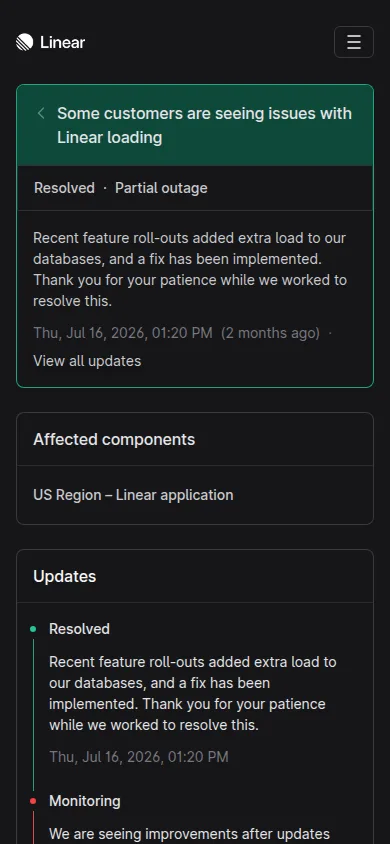
Source: https://linearstatus.com/incidents/9ews8tnv · Kind: live (past incident)
Job: show a failure with its scope, its severity and a timeline of updates.
Traits:
1. The title names the symptom in user words ("Some customers are seeing issues with Linear loading"), with no error code. [observed]
2. Status and severity appear as two words on one line under the title ("Resolved · Partial outage"). [observed]
3. A separate "Affected components" block names the broken part and shows the outage window on a time bar. [observed]
4. Updates are a timeline, newest first. Each update has a state word (Investigating → Monitoring → Resolved) and an absolute time. [observed]
5. Cause and fix are given in 1–2 plain sentences. [observed]

### 2c. incident.io — incident with affected and unaffected users
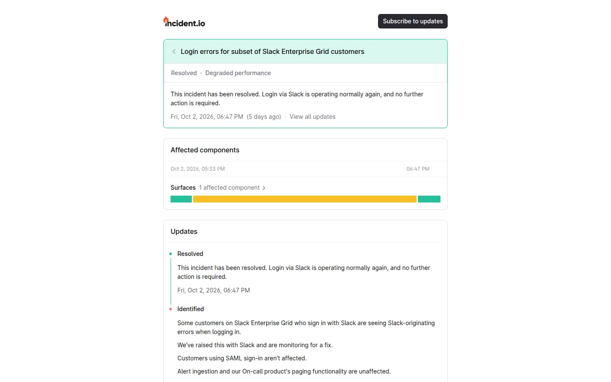 · phone: 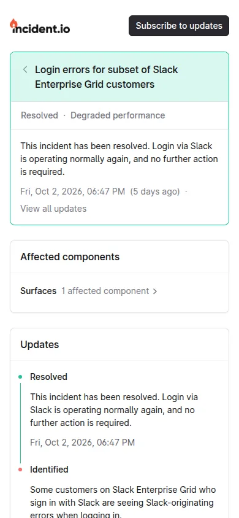
Source: https://status.incident.io/incidents/4ztahb1z · Kind: live (past incident)
Job: say who is affected and who is not, whose fault it is, and whether the reader must act.
Traits:
1. The resolution states the reader's next action explicitly, even when that action is "none" ("no further action is required"). [observed]
2. Scope is split into who is affected and who is not ("Customers using SAML sign-in aren't affected"). [observed]
3. The origin of the fault is named, and an upstream vendor fault is kept separate from the product's own fault. This maps to Azizam's gateway / provider / model layers. [observed]
4. Healthy, incident and resolved states use the same layout. [observed]

### 2d. Apple System Status — consumer verdict (phone)
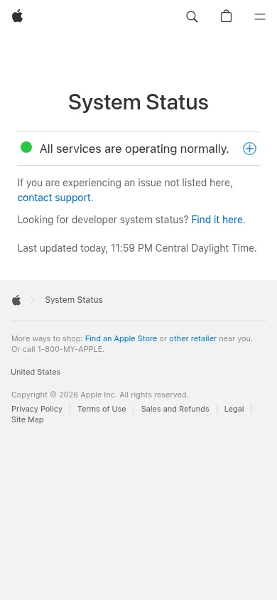 · desktop: 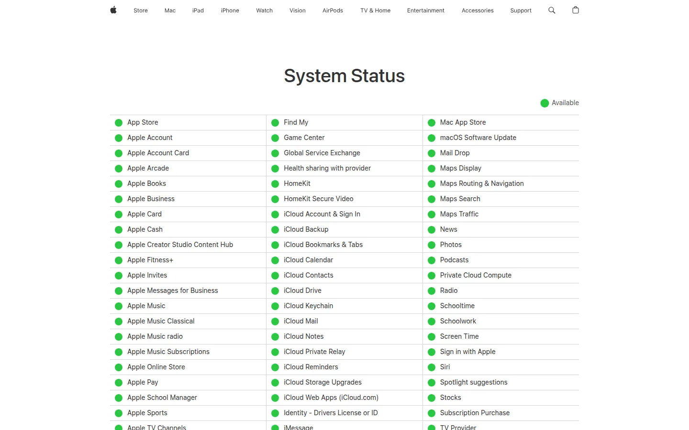
Source: https://www.apple.com/support/systemstatus/ · Kind: live
Job: a status verdict for non-technical people.
Traits:
1. At 390 px the whole answer is one sentence with a green dot ("All services are operating normally."), above the fold. [observed]
2. Services that are not broken are folded behind one "+" control on phone. [observed]
3. There is one escape route for unlisted problems ("contact support"). [observed]
4. "Last updated" is shown with a time and time zone. [observed]
5. On desktop, every service uses its consumer name, one row each, with the dot on the left. [observed]

**Anti-benchmarks:** the old board's GitHub, OpenAI and Vercel status pages repeat "operational" 3 or more times per screen. Apple's desktop list has 70+ equal rows, which is fine for consumers and useless to an owner. None of these says who is affected.

---

## 3. Library
Azizam job: let members browse, find and play what the household made (images, audio, video), with who, when and what visible.

### 3a. Midjourney — Explore grid
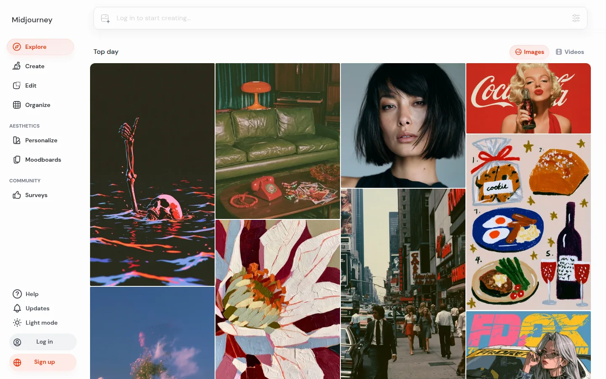 · phone: 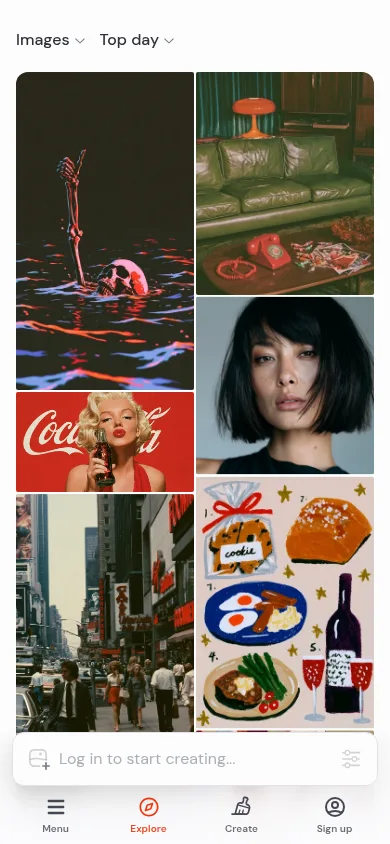
Source: https://www.midjourney.com/explore · Kind: live (public, logged out)
Job: scan many generated images at once.
Why: designers treat it as the reference gallery for generated media.
Traits:
1. Tiles keep their native aspect ratio (masonry), with no square crop. [observed]
2. Gutters between tiles are about 2 px, and tiles have no per-tile text or card chrome. [observed]
3. Media type (Images/Videos) and sort ("Top day") are two controls in one row above the grid. [observed]
4. Phone: 2 columns, the grid starts within about 70 px of the top, and navigation is a bottom tab bar of 4 or fewer items. [observed]
5. The create field stays visible (a bottom bar on phone). [observed]

### 3b. Suno — song detail (generated item)
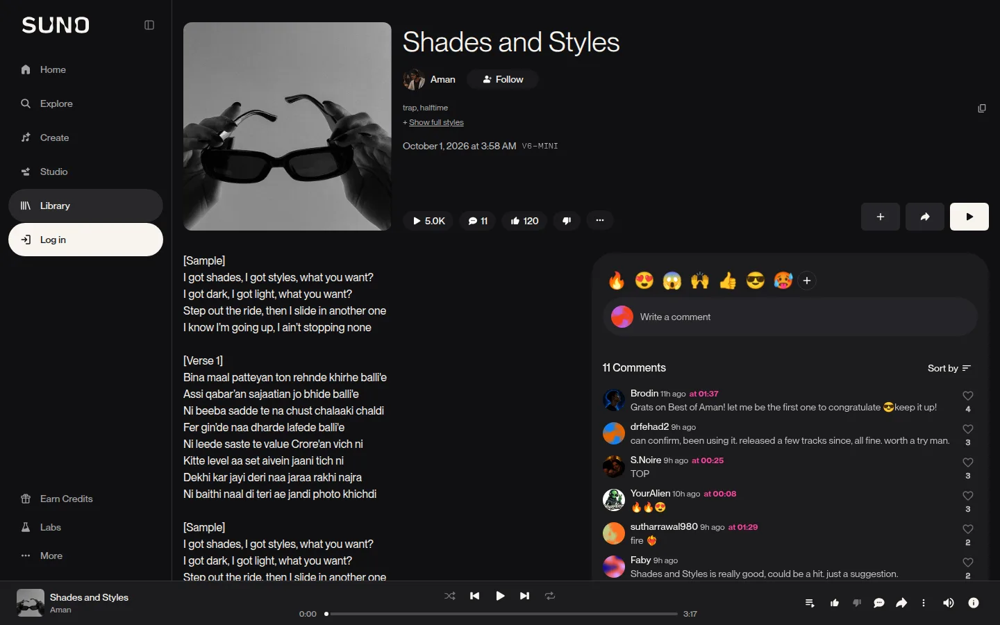 · phone:  · list: 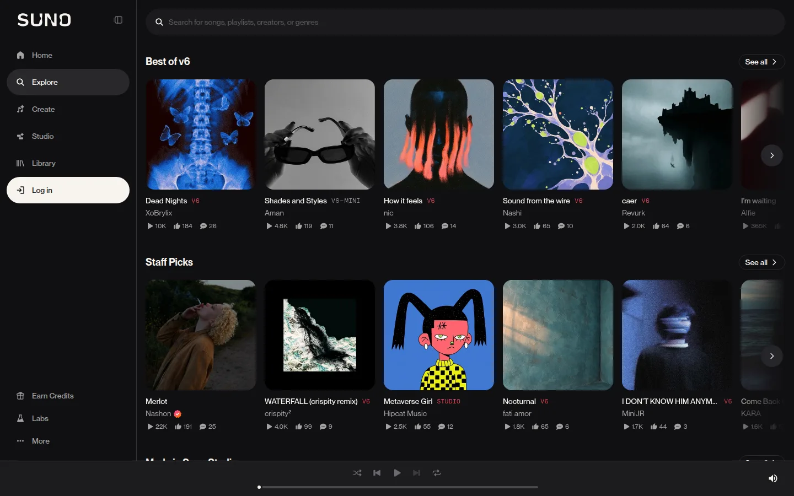
Source: https://suno.com/song/ee9cb5fb-02b7-4315-9e01-60cde0587c79 · https://suno.com/explore · Kind: live
Job: show one generated item with who made it, when, with what model and from what prompt, plus play.
Why: Suno leads the category for generated audio, and this was the only public generated-item detail page we found.
Traits:
1. The creator's avatar and name sit next to the title. [observed]
2. The exact timestamp ("October 1, 2026 at 3:58 AM") and a model badge ("V6-MINI") are on one line. [observed]
3. The prompt summary appears as style tags, with a "Show full styles" expander. [observed]
4. A player is always present at the bottom, and play is in the first viewport at 390 px. [observed]
5. List cards show title, creator and count metadata with no hover. [observed: explore]

### 3c. Apple Photos (iOS viewer) and Apple Music (audio list)
 · 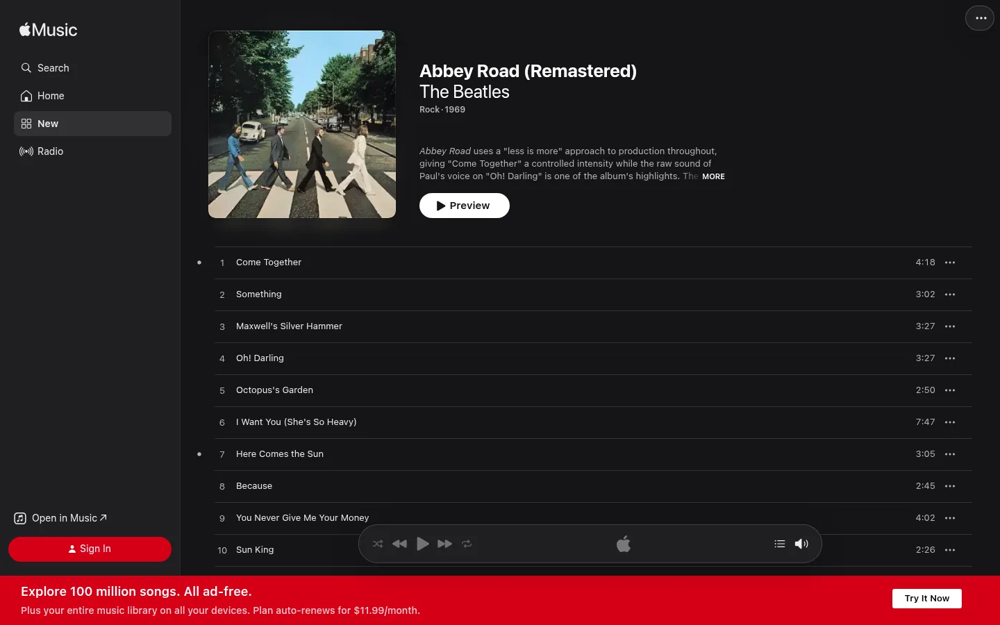 · phone: 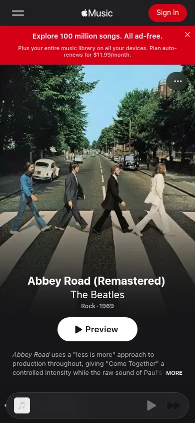
Source: https://www.apple.com/ios/photos/ (official shot) · https://music.apple.com/us/album/abbey-road-remastered/1441164426 (live)
Job: a single-item viewer, and an audio list with play.
Traits:
1. Viewer: the date and time are a single pill at the top. Back is on the left and an overflow menu on the right. [observed]
2. Viewer: a filmstrip of neighbouring items sits above a bottom action bar of 5 icons in thumb reach. [observed]
3. Audio row: index, title, right-aligned duration and an overflow menu. Row height is about 46 px. [observed]
4. One large play button sits next to the title block, and a mini-player floats over the list. [observed]
5. Provenance (who, details) is one tap away behind an info button, not on the canvas. [inferred]

**Gap:** we found no public mixed-media library (image, audio and video in one list). **Anti-benchmarks:** Suno's phone view and Apple Music's web view both lose content height to "open the app" banners.

---

## 4. Try (playground)
Azizam job: pick a model or workflow, enter input, run it, and see the result with time and cost.

### 4a. Replicate — model playground
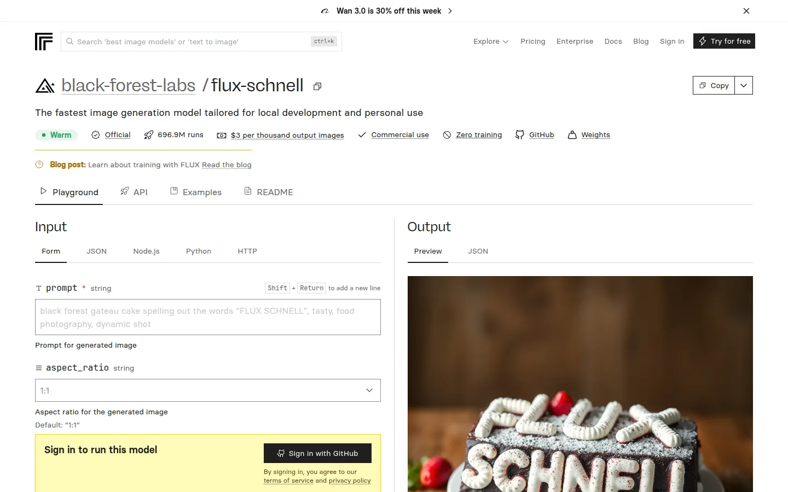 · phone: 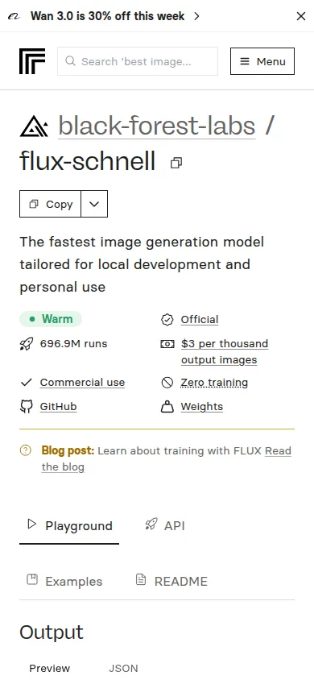
Source: https://replicate.com/black-forest-labs/flux-schnell · Kind: live
Job: input on the left, output on the right, with a form generated from the model's schema.
Why: this is the standard model-playground layout that fal, Krea and others copy.
Traits:
1. Two equal columns, Input and Output, with a divider. [observed]
2. Price is shown before running ("$3 per thousand output images"). [observed]
3. Readiness is a chip next to the model ("Warm"). [observed]
4. Each field shows its name, a required marker, helper text and its default ("Default: 1:1"). [observed]
5. The output pane shows an example result before the first run, so it is never empty. [observed]
6. Anti-trait: on phone, the run action is not in the first 844 px. Azizam must beat this. [observed]

### 4b. Replicate — finished run
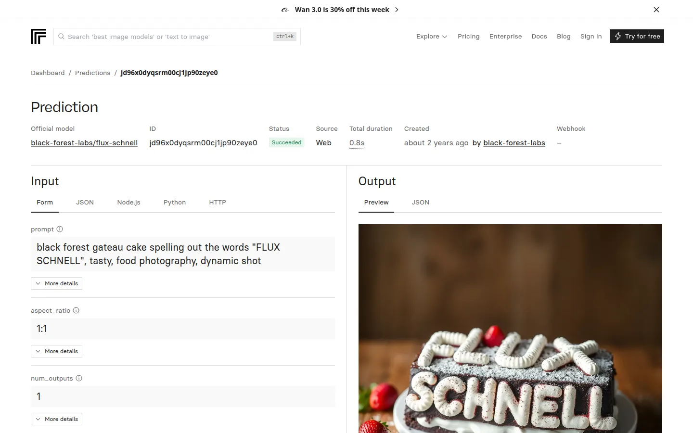 · phone: 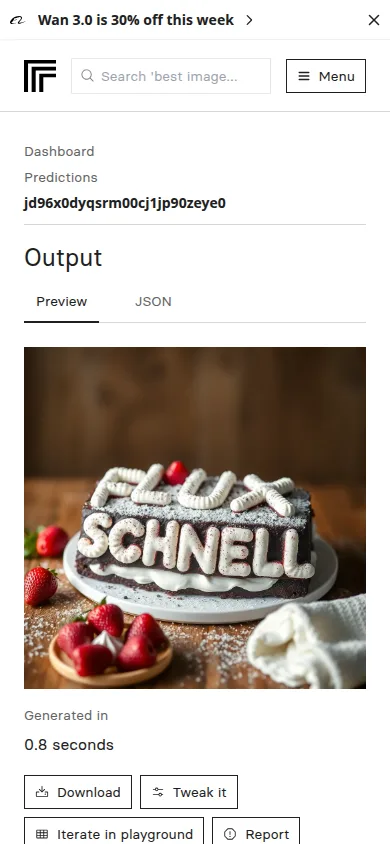
Source: https://replicate.com/p/jd96x0dyqsrm00cj1jp90zeye0 · Kind: live
Job: a finished run with status, duration and inputs. It also works as a Library item detail.
Traits:
1. A header row of labelled facts: model, ID, a "Succeeded" status chip, total duration "0.8s", and created time with the user. [observed]
2. Phone: the output comes first, then "Generated in 0.8 seconds", then the next actions (Download, Tweak it, Iterate). [observed]
3. Every input parameter is shown read-only, so the run can be reproduced. [observed]
4. Inputs can be viewed as code (Form, JSON, Node.js, Python, HTTP), so the same run can be repeated from a client. [observed]
5. Cost is not shown. Azizam should show it. [observed absence]

### 4c. Vercel AI SDK Playground — model compare
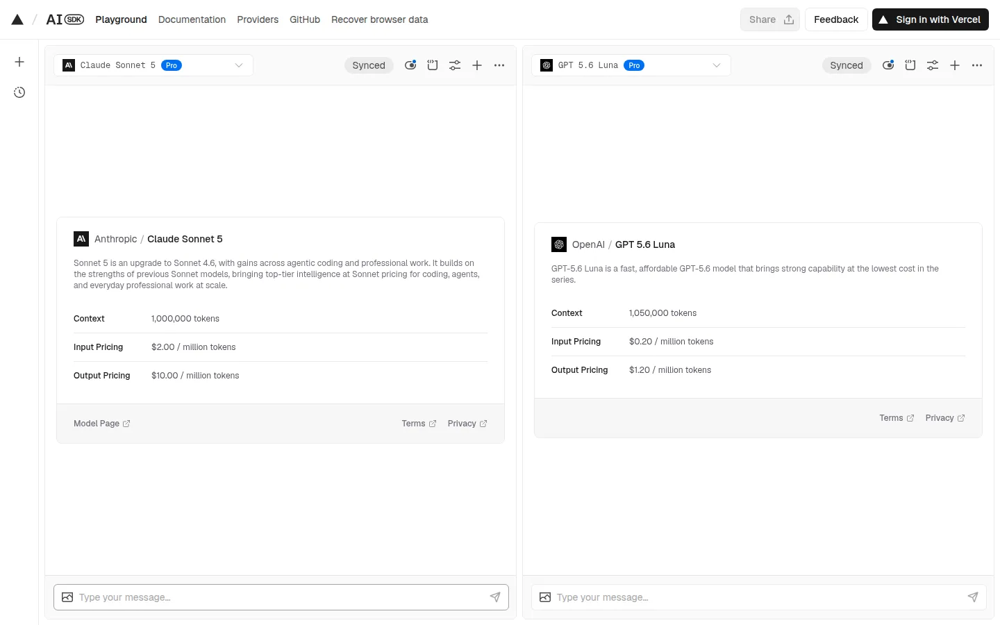 · phone: 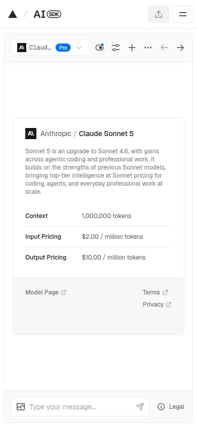 · also: 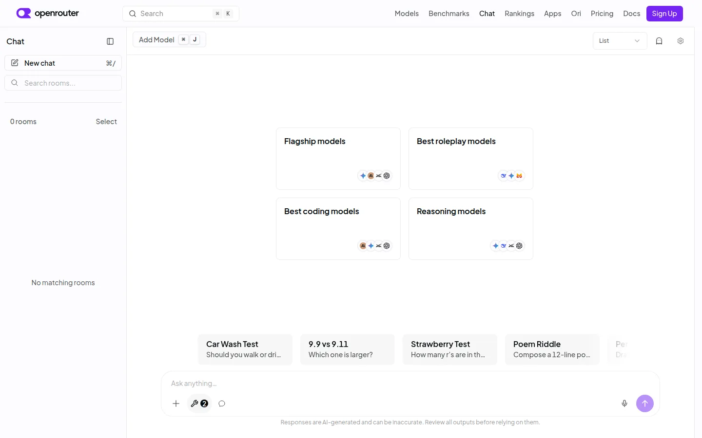 · 
Source: https://ai-sdk.dev/playground · https://openrouter.ai/chat · Kind: live
Job: pick models and chat side by side, with prices shown before running.
Traits:
1. The model picker is at the top left of each pane, with a provider icon. [observed]
2. An empty pane shows a model card (description, context, input and output price per million tokens) instead of being blank. [observed]
3. The composer is one line at the bottom of the pane. On phone it stays within the bottom 100 px. [observed: OpenRouter phone]
4. Starter prompts are offered as chips above the composer. [observed: OpenRouter]

**Gap:** no public playground shows cost and latency together after a run. **Anti-benchmark:** fal.ai's playground shows a grey "Idle" result box, and an announcement pop-up covered the form on every capture.

---

## 5. Models & Workflows catalog
Azizam job: show what the gateway can do and which model fits which job, with price and speed.

### 5a. Vercel AI Gateway — Models
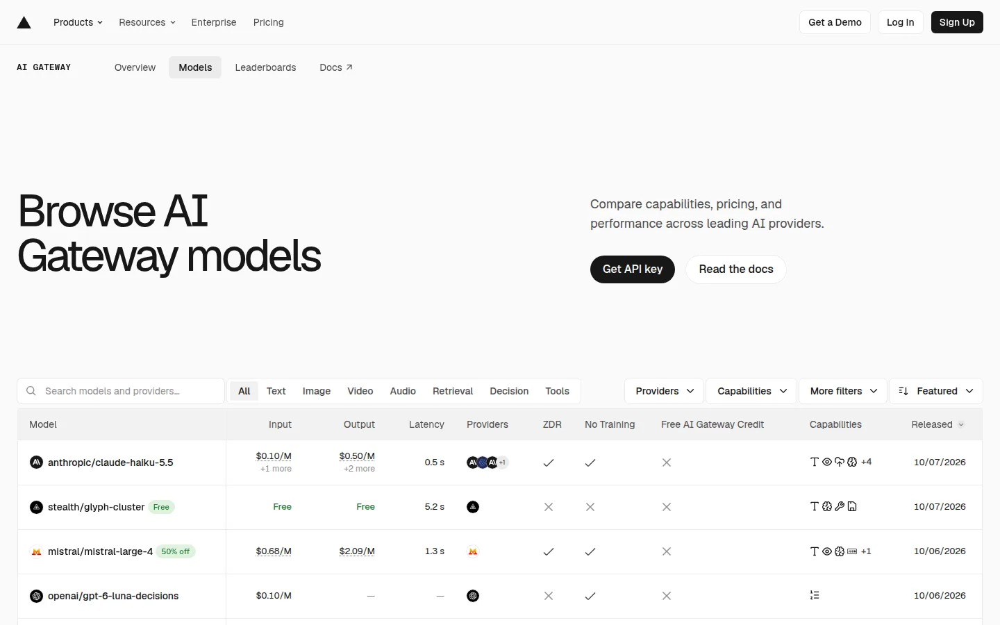 · phone: 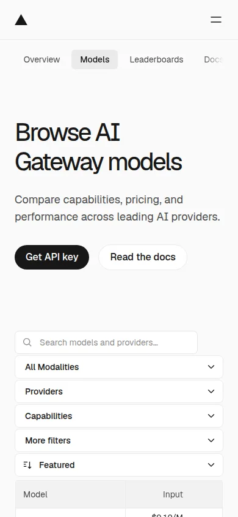
Source: https://vercel.com/ai-gateway/models · Kind: live
Why: the same product category (an OpenAI-compatible gateway), from a named bar (Geist).
Traits:
1. Modality tabs (All, Text, Image, Video, Audio…) and a search field are in one row. [observed]
2. Each row shows name, input $/M, output $/M, latency in seconds, providers and release date, with no hover. [observed]
3. Numeric columns are right-aligned. [observed]
4. Missing values are shown as "—", not 0. [observed]
5. Price tags ("Free", "50% off") sit next to the name as small pills. [observed]

### 5b. OpenRouter — model list and model detail
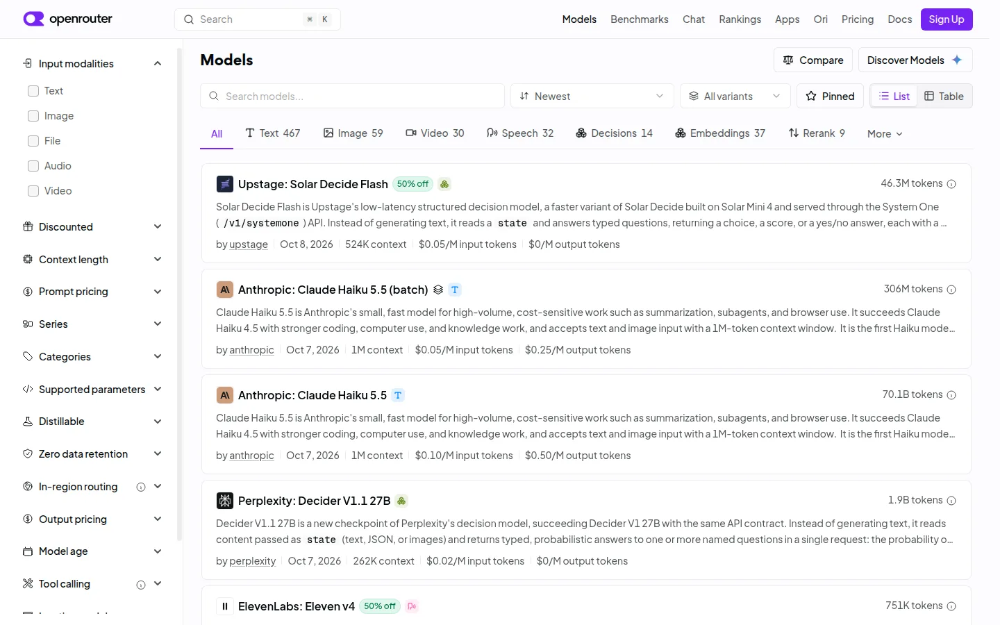 · phone: 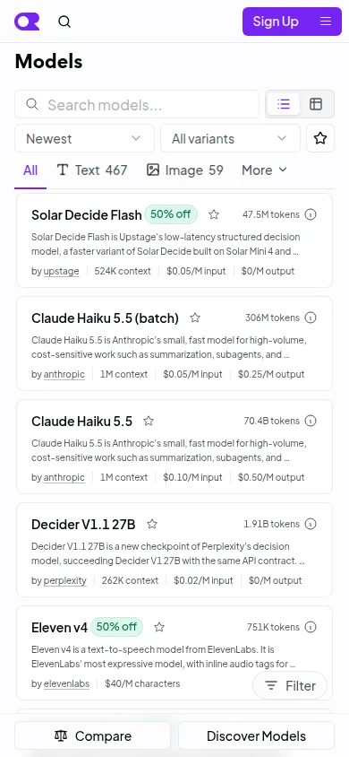 · detail: 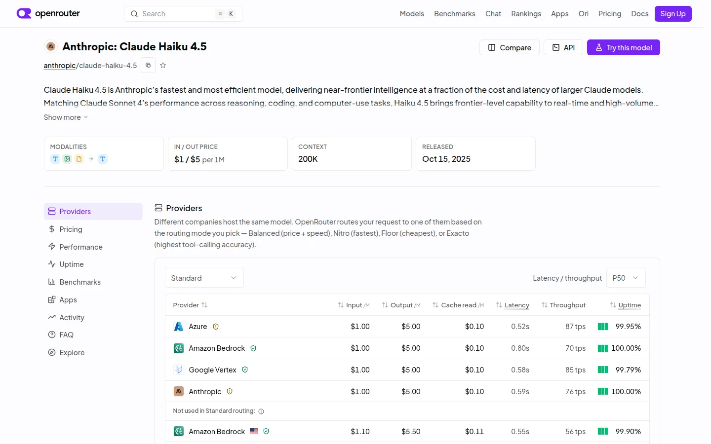 · 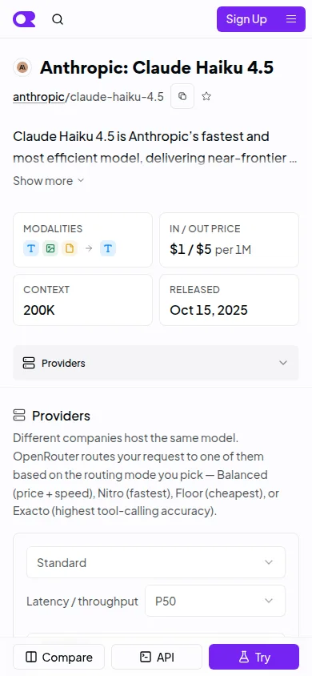
Source: https://openrouter.ai/models · https://openrouter.ai/anthropic/claude-haiku-4.5 · Kind: live
Traits:
1. A list row has the name, a 2-line description, vendor, date, context and price in and out. [observed]
2. Category tabs show counts (for example "Text 467"). [observed]
3. Detail: 4 summary facts (modalities, price, context, released) are above the fold. [observed]
4. Phone detail: a bar fixed at the bottom holds Compare / API / Try, so the next step is in thumb reach. [observed]

### 5c. Vercel AI Gateway — getting started (catalog to first call)
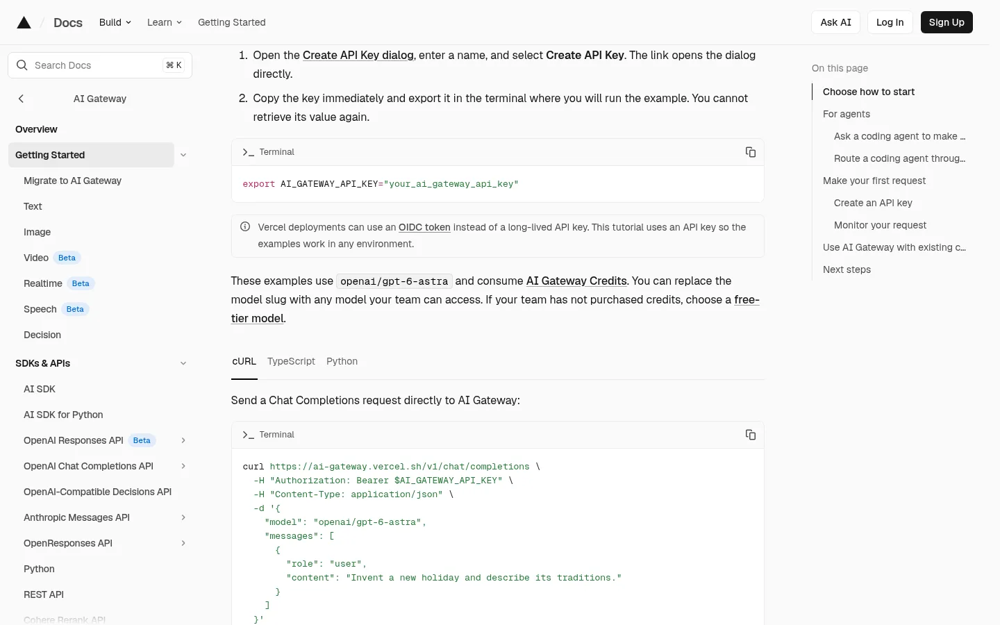
Source: https://vercel.com/docs/ai-gateway/getting-started (scrolled about 1700 px) · Kind: live docs
Job: connect "this model" to "here is the call that uses it".
Traits:
1. The model slug in the prose is the same slug as in the code snippet (`openai/gpt-6-astra`). [observed]
2. The page opens with a goal-to-action table ("Choose how to start"). [inferred from page outline; not in this frame]

**Anti-benchmark:** Replicate /explore is marketing-led and does not answer "which model for which job".

---

## 6. Apps & API keys
Azizam job: create a key, show it once, and connect a named client.

### 6a. Cloudflare — token created (shown once)
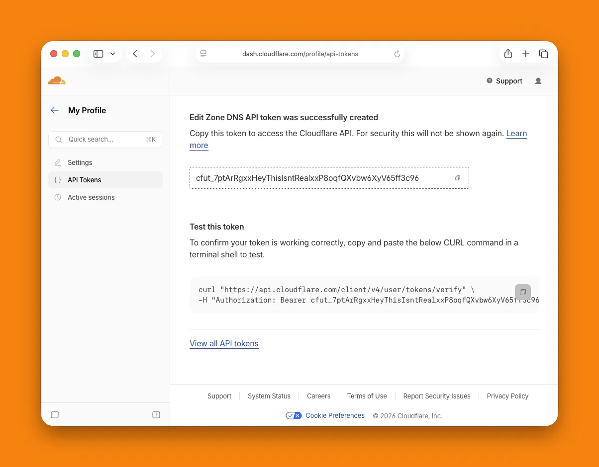
Source: https://developers.cloudflare.com/fundamentals/api/get-started/create-token/ · Kind: docs
Traits:
1. The success heading names the object ("Edit Zone DNS API token was successfully created"). [observed]
2. The secret is in one boxed field with a copy icon inside the right edge. [observed]
3. The "shown once" warning is one sentence of 15 words or fewer in the body ("For security this will not be shown again."), not a modal. [observed]
4. The next step is a copyable test command already filled in with the new secret ("Test this token"). [observed]
5. There is exactly one exit link ("View all API tokens"). [observed]

### 6b. Resend — API keys list
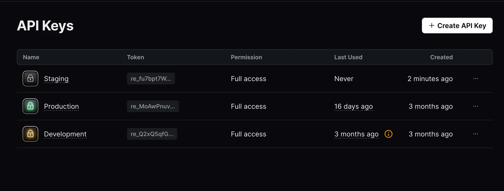
Source: https://resend.com/docs/dashboard/api-keys/introduction · Kind: docs
Why: Resend is widely praised as a Linear/Vercel-grade developer dashboard.
Traits:
1. One primary "Create API Key" button at top right, and no helper paragraph above the table. [observed]
2. A row shows name, a token prefix of about 10 characters plus "…", permission, last used and created, with no hover. [observed]
3. "Last used" is relative ("Never", "16 days ago"). A stale key gets a warning icon. [observed]
4. Row actions are collapsed into one "…" menu. [observed]

### 6c. Vercel AI Gateway — copy once, then a recipe per client

Source: https://vercel.com/docs/ai-gateway/getting-started · Kind: live docs
Traits:
1. The copy-once instruction is plain words ("Copy the key immediately… You cannot retrieve its value again."). [observed]
2. Recipe tabs number 3 (cURL, TypeScript, Python), with the first one selected. [observed]
3. Each code block has a copy button at top right. [observed]
4. The snippet is complete: base URL, auth header and model slug are all in it. [observed]

### 6d. Tailscale — choose your device (connect a client)
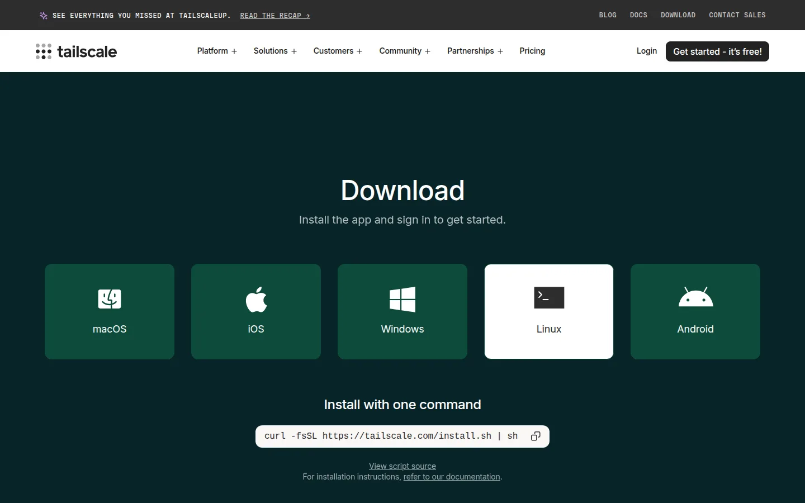 · phone: 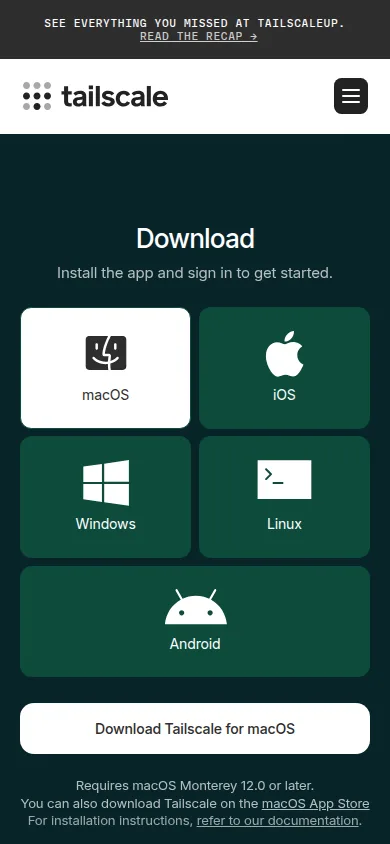
Source: https://tailscale.com/download · Kind: live
Traits:
1. One instruction line of 8 words or fewer under the title. [observed]
2. Platforms are large tiles, each with an icon and a 1-word label. [observed]
3. Phone: a full-width primary button for the detected OS is in the first viewport. [observed]
4. The technical route is one copyable command with a copy button. [observed]

**Note:** Stripe's documented rule (user-created keys are shown once; rotation keeps the old key valid for up to 7 days) is in divan `product-design/stripe-lets-you-re-reveal-only-keys…`. Its docs images are icons, so there are no Stripe pixels for this job.

---

## 7. Usage & Activity
Azizam job: show spend, requests, a per-request receipt, and failures.

### 7a. Vercel AI Gateway — Usage overview and spend by key
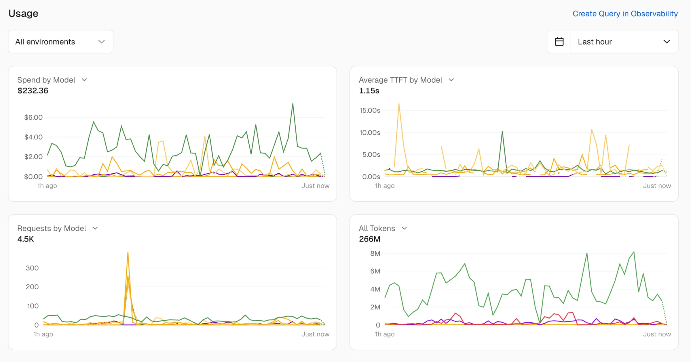 · by key: 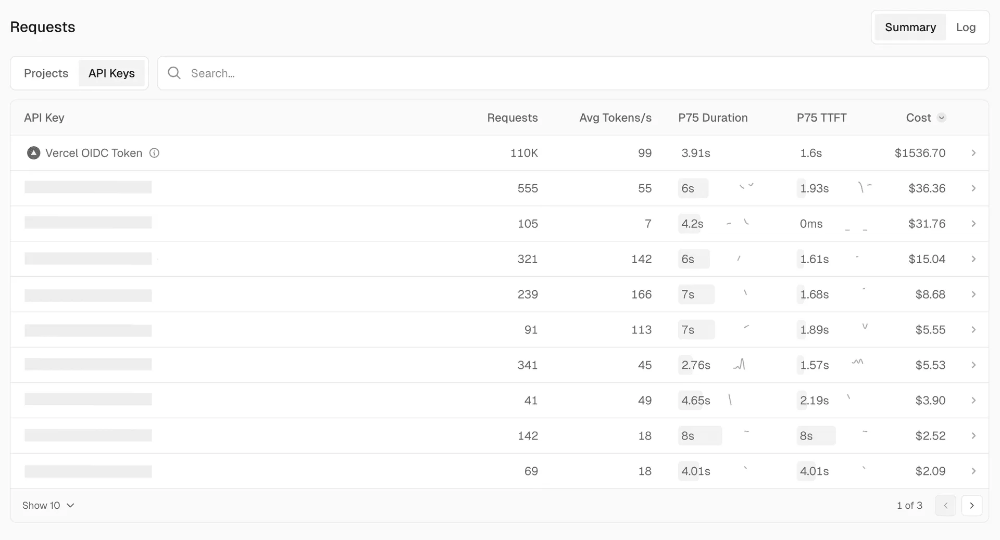 · by project: 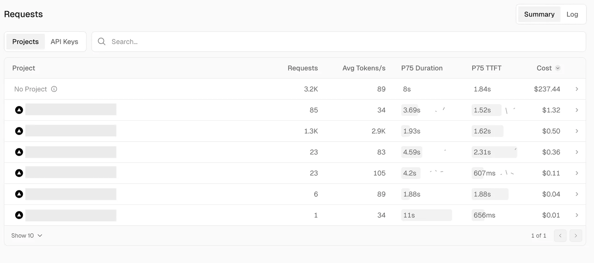
Source: https://vercel.com/docs/ai-gateway/observability · Kind: docs
Why: the closest same-job product (an AI gateway), with Geist craft.
Traits:
1. Each chart card has a title, then one headline number ($232.36, 1.15s, 4.5K, 266M), then the chart. [observed]
2. The page has two controls: environment and time window. [observed]
3. The incomplete current interval is drawn dotted. [observed]
4. The by-key table has Requests, Tokens/s, P75 duration, P75 TTFT and Cost. Numbers are right-aligned and tabular, and Cost is the last column, sortable. [observed]
5. Each row ends in a chevron that drills down. [observed]

### 7b. Stripe Workbench — request log and errors
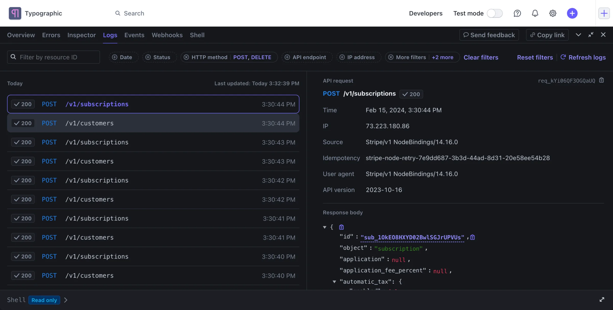 · errors: 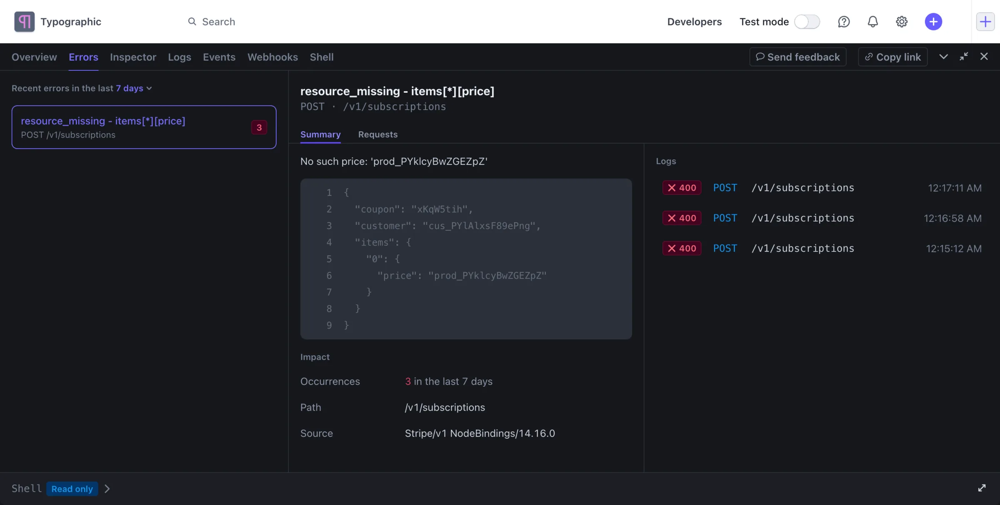
Source: https://docs.stripe.com/workbench/overview · Kind: docs
Traits:
1. A row shows a status chip (200/400), method, path and time, with no hover. [observed]
2. Selecting a row opens the receipt beside the list (split view), without a page change. [observed]
3. The receipt starts with the request ID and a copy icon, then label/value rows (time, IP, source, API version). [observed]
4. Errors are grouped by cause with a count, and the detail starts with one human sentence of reason. [observed]
5. An "Impact" block gives occurrences over 7 days and the source, and the failing request body sits beside it. [observed]

### 7c. Resend — log detail; OpenRouter — activity
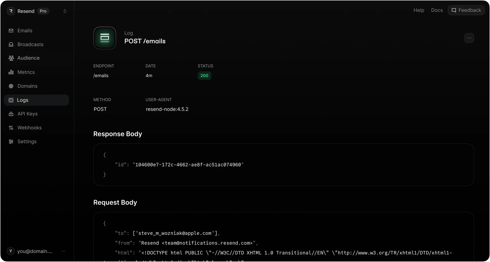 · 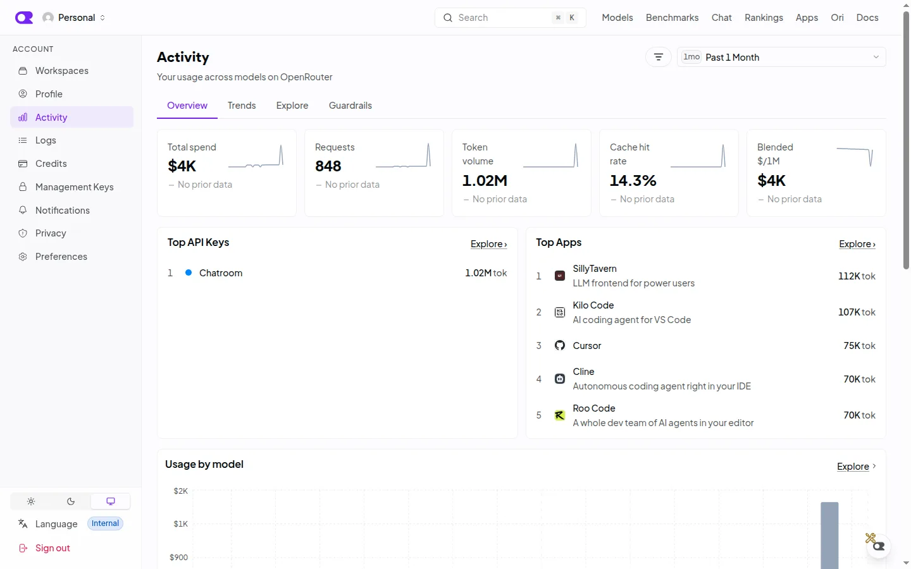
Source: https://resend.com/features/email-api (official shot) · https://openrouter.ai/docs/guides/features/activity (docs)
Traits:
1. Receipt title is "POST /emails", not an ID. Its facts sit in a label-over-value grid (endpoint, age, status, method, user agent). [observed]
2. The response body comes before the request body, both in monospace. [observed]
3. Activity: a row of 5 KPI tiles, each with a label, a number and a sparkline. [observed]
4. Top keys and top apps are ranked lists with right-aligned counts. [observed]

**Gap:** no public receipt shows **cost per request** next to status. Azizam should add it.

---

## 8. Engines & Providers (owner)
Azizam job: the owner sees each backend with its health, connects credentials, and sets caps.

### 8a. Raycast — Settings > AI: models and providers
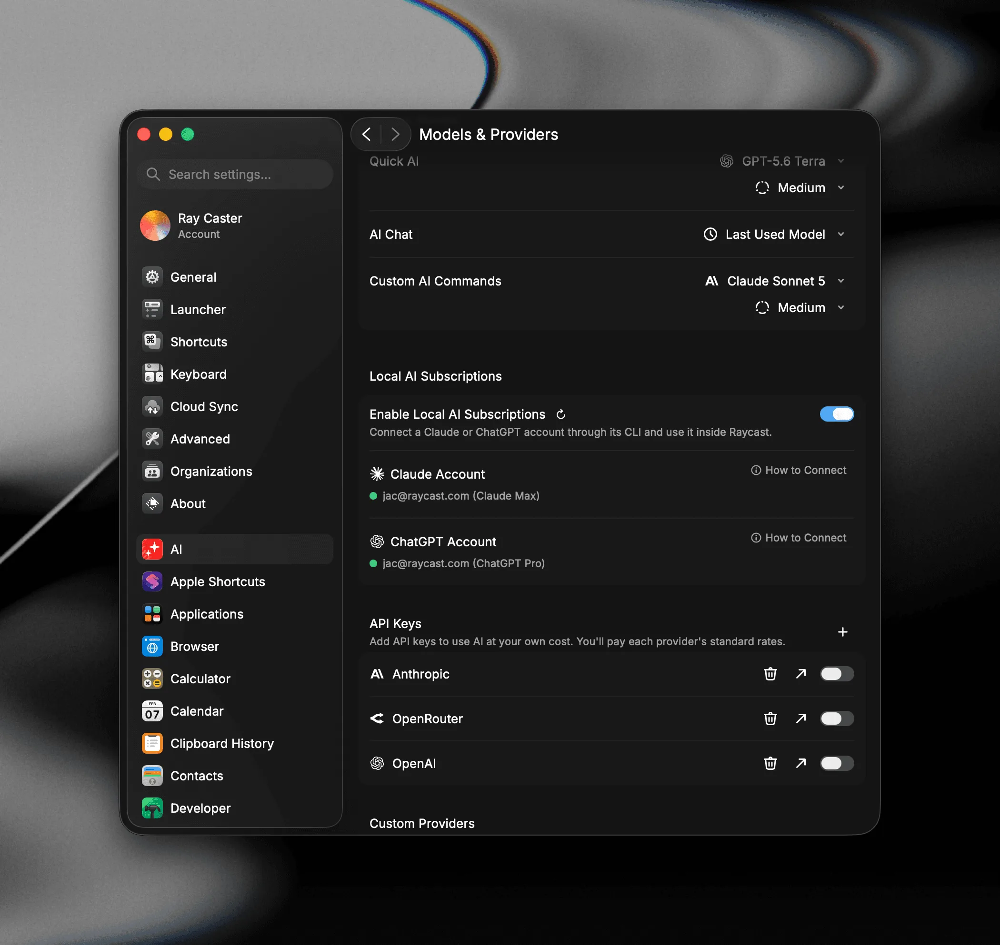 · custom providers: 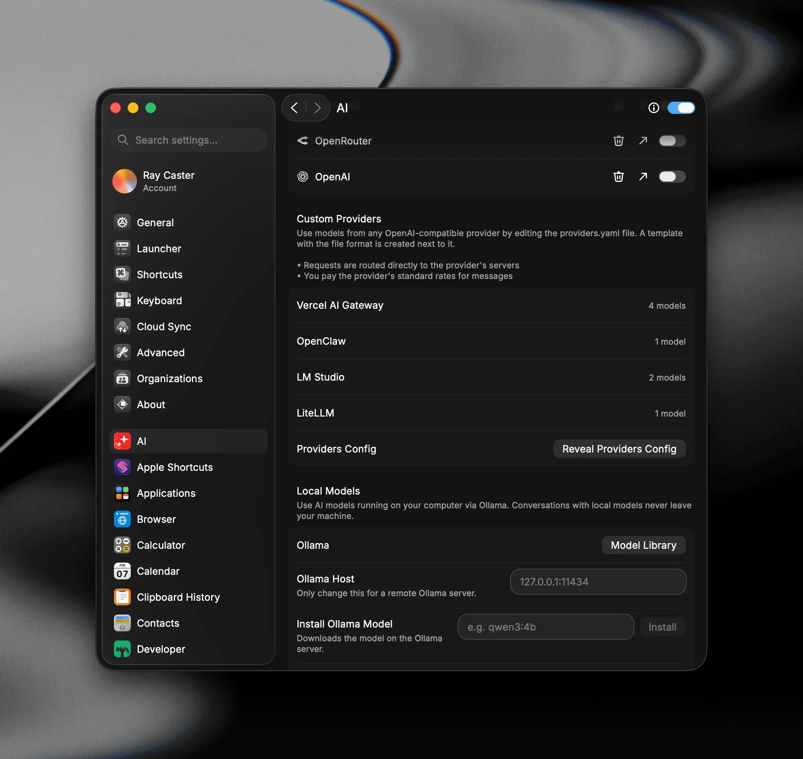
Source: https://manual.raycast.com/ai/bring-your-own-subscription · https://manual.raycast.com/ai/custom-providers · Kind: docs (official)
Why: a Mac-native, design-led product that has the same model as Azizam: local backends (Ollama, LM Studio, LiteLLM), subscriptions and API keys in one list.
Traits:
1. Each provider is one row: logo, name, then actions (delete, open, toggle) on the right, with no hover. [observed]
2. A connected account shows a green dot plus its identity and plan ("jac@raycast.com (Claude Max)"). [observed]
3. Each group has one cost sentence of 12 words or fewer ("You'll pay each provider's standard rates.") and a "+" add button. [observed]
4. Local backends get one row each with a right-aligned "N models" count. [observed: custom providers]
5. The default model per use is a right-aligned select on the row ("AI Chat → Last Used Model"). [observed]

### 8b. OpenRouter — providers for one model (health table)
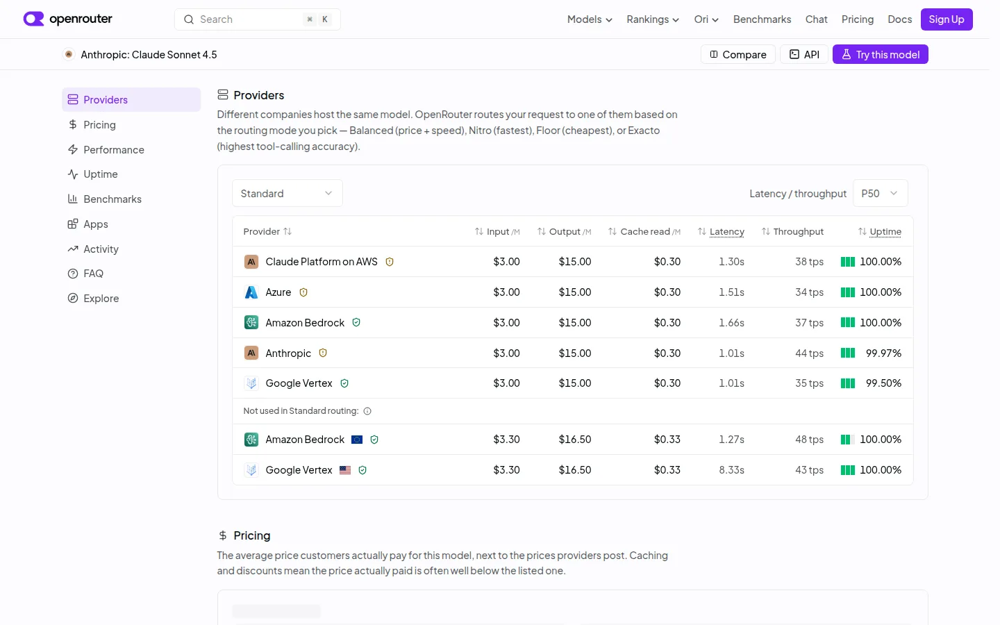 · phone: 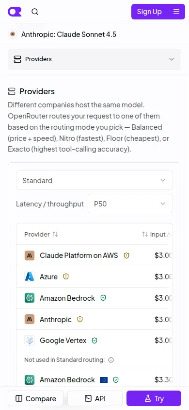
Source: https://openrouter.ai/anthropic/claude-sonnet-4.5/providers · Kind: live
Traits:
1. One row per backend: price in and out, latency, throughput and uptime %, on one line. [observed]
2. Uptime is a % plus a small bar, not colour alone. [observed]
3. Numeric columns are right-aligned and sortable. [observed]
4. Backends not used by the current routing are below a labelled divider. [observed]
5. One sentence above the table explains how a backend is chosen. [observed]

### 8c. Vercel — Spend Management (cap)
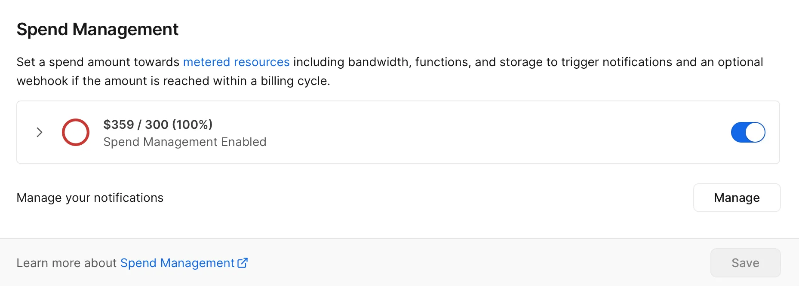
Source: https://vercel.com/docs/spend-management · Kind: docs
Traits:
1. Use against the cap is one string ("$359 / 300 (100%)") plus a ring gauge. [observed]
2. The state is named in words under the figure ("Spend Management Enabled"), with one toggle. [observed]
3. Over the cap, the gauge turns red. [observed]
4. Save is disabled until something changes. [observed]

**Gap:** we found no owner console that shows **health per backend with an error state and a fix**. Tailscale's Machines page would be the reference, but its KB has no public screenshots. **Anti-benchmark:** Vercel shows 100% of the cap in red but offers no next action beyond "Manage".

---

## 9. People, invites & access plans
Azizam job: the owner invites household members, chooses what they can use and spend, and sees who has joined and who is pending.

### 9a. Clerk — OrganizationProfile, Members
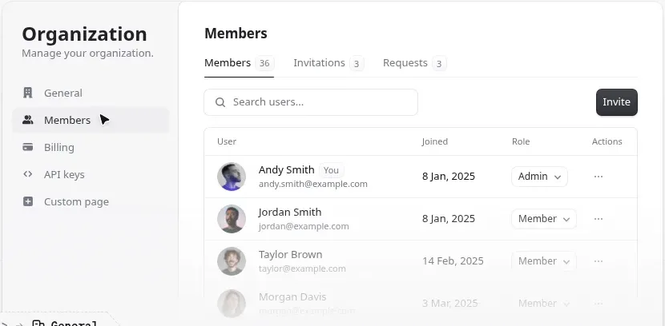 (crop of `people/clerk-organization-profile-desktop.webp`)
Source: https://clerk.com/components/organization-profile · Kind: live (Clerk's real component rendered on its page)
Traits:
1. Tabs show counts: "Members 36 / Invitations 3 / Requests 3". Pending invites are one click away. [observed]
2. A row shows avatar, name, email, joined date, role and an action menu, with no hover. [observed]
3. The current user is tagged "You". [observed]
4. Role is changed inline with a select on the row. [observed]
5. One dark primary "Invite" button sits next to the search field. [observed]

### 9b. Vercel — invite and role picker
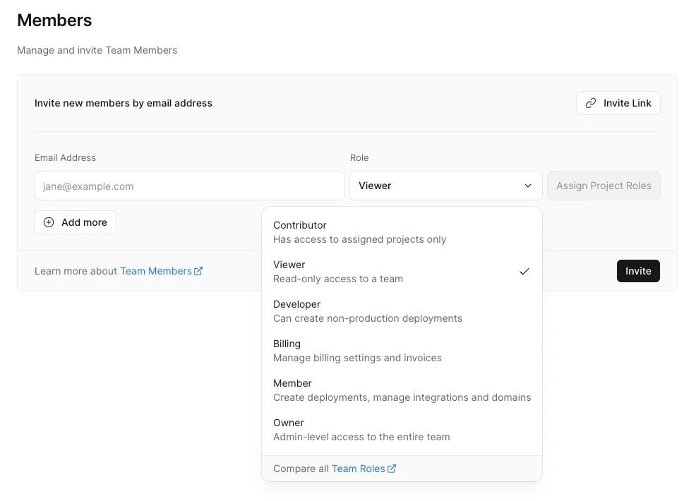
Source: https://vercel.com/docs/rbac/managing-team-members · Kind: docs
Traits:
1. Every role option has a plain consequence of 8 words or fewer ("Read-only access to a team"). [observed]
2. Email and role are in one row, and "Add more" allows a batch invite. [observed]
3. One primary "Invite" button, with "Invite Link" as the secondary route. [observed]
4. The optional narrowing step ("Assign Project Roles") stays disabled until it applies. [observed]

### 9c. Linear — team permissions
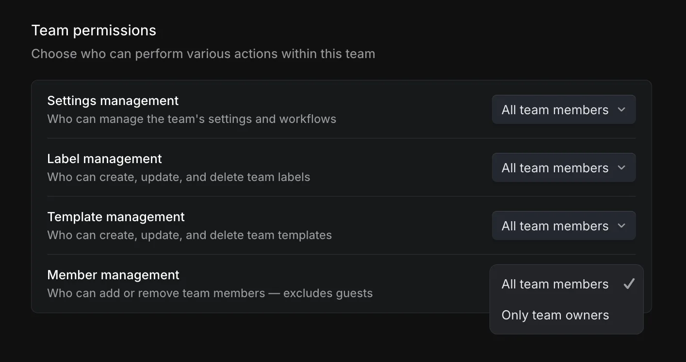
Source: https://linear.app/docs/members-roles · Kind: docs
Traits:
1. Each permission is named as a capability, with a "Who can…" helper line. [observed]
2. The choice is between 2 plain options ("All team members" / "Only team owners"). [observed]
3. It uses the same row anatomy as Settings (10a), so there is no new pattern to learn. [observed]

---

## 10. Settings
Azizam job: owner and member find a setting fast and change it, with the current value always visible.

### 10a. Linear — settings index and detail
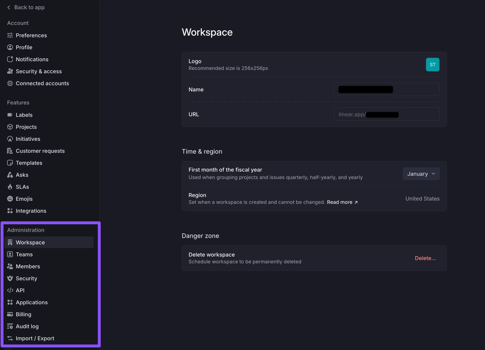 · detail: 
Source: https://linear.app/docs/workspaces · https://linear.app/docs/account-preferences · Kind: docs
Traits:
1. The sidebar has groups (Account, Features, Administration), each with a muted label. Item names are 2 words or fewer, with icons. [observed]
2. "Back to app" is the first element, so settings is a separate place with one exit. [observed]
3. A row is a label, one grey helper line, and a control on the right that shows its current value. [observed]
4. Rows sit in titled cards. "Danger zone" comes last and uses red text. [observed]
5. There is no Save button; changes apply in place. [inferred]

### 10b. Raycast — settings window
 · also 8a
Source: https://manual.raycast.com/settings · Kind: docs
Traits:
1. The account is the first sidebar item, with a name and a subtitle. [observed]
2. Subscription state is a word in green ("Active"). [observed]
3. A "Search settings…" field sits above the sidebar. [observed: 8a]
4. "Sign Out" is red text at the bottom. [observed]

**Gap:** we found no official iOS Settings imagery (Apple's pages show only hero art).

---

## 11. Sign-in, invite acceptance, first-run setup
Azizam job: get a household member from an invite link to signed in, on a phone, with as few choices as possible. Get the owner through first-run setup.

### 11a. Linear — log in
 · phone: 
Source: https://linear.app/login · Kind: live
Traits:
1. One heading ("Log in to Linear") and no marketing copy. [observed]
2. At most 4 sign-in buttons. One is filled; the rest are outlined. [observed]
3. The screen has 12 words of body text or fewer, not counting button labels. [observed]
4. At 390 px the whole form fits with no scroll. [observed]
5. Sign-up is one text link. [observed]

### 11b. Vercel — log in
 · phone: 
Source: https://vercel.com/login · Kind: live
Traits:
1. The email field and a dark "Continue with Email" are the first two controls. [observed]
2. Other providers are outlined buttons below a divider, and rare options sit behind "Show other options". [observed]
3. Phone: the whole form is in the first viewport. [observed] (A Google one-tap sheet overlaps it; that is third-party UI.)

### 11c. Discord — invite landing (invitee view)

Source: https://discord.com/invite/python · Kind: live (desktop only; the phone render was blank)
Why: a mainstream, non-technical invite acceptance page that is public with no login. No best-in-class B2B product exposes one.
Traits:
1. "You've been invited to join" plus the target name, in larger type, above any field. [observed]
2. One line of context under the name (online and member counts). For Azizam: who invited you. [observed]
3. One filled primary button. The existing-account route is one text link. [observed]
4. Anti-trait: it asks for a date of birth. Azizam should ask only for a name, or nothing. [observed]

### 11d. Home Assistant — first-run "Create user" (category floor, not the league)

Source: https://www.home-assistant.io/getting-started/onboarding/ · Kind: docs
Why: we found no public pixels of a best-in-class first-run setup. This is the closest self-hosted household peer, so use it as the **floor**: Azizam must at least match it.
Traits:
1. One title and one intro sentence of 9 words or fewer. [observed]
2. 4 fields, all labelled. [observed]
3. The primary button stays disabled until the form is valid. [observed]
4. Language and help are in the footer, not in the form. [observed]

---

## 12. Empty and error states
Azizam job: say what is empty and what to do next, name the failing layer (gateway, key, model, workflow) and the fix, and handle not-found.

### 12a. Stripe — 404
 · phone: 
Source: https://stripe.com/this-does-not-exist · Kind: live
Traits:
1. A headline of 3 words or fewer ("Page not found"). [observed]
2. One sentence of 15 words or fewer, plus a home link. [observed]
3. Instead of a dead end, it offers destinations, each with a title and a one-line purpose. [observed]
4. "System status" is offered as one of the exits. [observed]

### 12b. Vercel — failed build: row state and log cause
 · log: 
Source: https://vercel.com/docs/deployments/troubleshoot-a-build · Kind: docs
Traits:
1. The failed row has a red dot, the word "Error" and a duration, so the state is not shown by colour alone. [observed]
2. The log puts the cause on one line starting with "Error:" and names the failing unit. [observed]
3. The fix is a "Read more:" link to a specific docs page. [observed]

### 12c. Vercel Geist — Error and Empty State rules
 ·  · phones:  
Source: https://vercel.com/geist/error · https://vercel.com/geist/empty-state · Kind: live (design system)
Traits:
1. An inline error is one sentence with an icon, and can carry a label prefix that names the source ("Email Error:"). For Azizam: "Gateway:", "Key:", "Model:". [observed]
2. Empty states come in four types by intent: Blank Slate, Informational (inline CTA plus docs link), Educational and Guide. A first-run empty state must include an inline CTA. [observed: rules]

### 12d. OpenRouter — first-run chat and no-results
 · phone:  · no results:  · phone: 
Source: https://openrouter.ai/chat · https://openrouter.ai/models?q=zzqxv · Kind: live
Traits:
1. The empty chat is filled with starter cards and prompt chips, so the next action is visible. [observed]
2. With no results, every tab shows its count as 0, so the user sees the search caused the empty view. [observed]
3. Anti-trait: "No matching models found for your search." offers no "Clear search" action. Azizam's empty state must name one. [observed]

**Gap:** we found no flagship screen that names the failing **layer** and the fix in one view. Azizam has to set this bar itself (playbook G4). **Anti-benchmark:** the default Next.js 404 ("This page could not be found.") offers no exit.

---

## 13. Phone layouts
Azizam job: member surfaces at 390 px, with a list that shows status, the primary action in thumb reach, and a detail view.

### 13a. Things 3 (iPhone)
 · 
Source: https://apps.apple.com/us/app/things-3/id904237743 · Kind: official shot
Why: two Apple Design Awards (see divan `product-design/things3-partitions…`). It is the usual example of calm list design.
Traits:
1. List rows are about 44 pt tall: icon, title, and a right-aligned count. [observed]
2. A badge appears only where action is needed. [observed]
3. A round "+" primary button is at bottom right, in thumb reach. [observed]
4. A row subtitle gives context in grey (the project name). [observed]
5. Search is a visible field at the top ("Quick Find"), not just an icon. [observed]

### 13b. Stripe Dashboard iOS — detail
 · home: 
Source: https://apps.apple.com/us/app/stripe-dashboard/id978516833 · Kind: official shot
Traits:
1. Detail view: a back chevron and a centred title. [observed]
2. Status is a coloured word next to the amount ("succeeded", "Active"). [observed]
3. The primary action is a full-width filled button at the bottom ("Copy link"), with "…" next to it. [observed]
4. Detail rows put the label on the left and the value on the right. [observed]

### 13c. Live phone captures elsewhere on this board
Apple System Status (2d), Midjourney (3a), Suno detail (3b), Replicate run (4b), OpenRouter model detail (5b), Tailscale download (6d), Linear login (11a). Common traits to check:
1. The verdict or primary action is inside the first 844 px. [observed in 2d, 3b, 5b, 6d, 11a]
2. No horizontal scroll, except deliberate table scroll (5a). [observed]
3. Persistent controls (player, composer, bottom bar) are within the bottom 100 px. [observed in 3a, 3b, 4c, 5b]
