# Azizam visual reference board

20 references, plus 6 anti-references. Public captures: **2026-10-07**. Use pixels before prose: open the linked image, then read TAKE and NOT. Directions should cite an R id, a principle, and any relevant ban-list rule.

The seven owner handoff images remain in `../assets/reference-ui/`. They are visual authority, not shipped-product evidence. All other references are public shipped interfaces or official product imagery, captured with a privately launched headless Chromium browser and fresh contexts. No login, accounts, shared browser or generated images were used.

Desktop source viewports: 1440 × 900; mobile: 390 × 844; device scale 1. Product-image crops retain their native displayed size rather than pretending to be responsive app screenshots. Mobile links accompany live surfaces; official image crops cannot prove the product's responsive behavior. Files are WebP quality 80, no wider than 1440 px. Full-page captures change fixed/sticky elements to static first (ban 31); use viewport captures to judge the actual shell.

**Measurable trait** means a proposed screenshot acceptance check for Azizam derived from the reference, unless explicitly marked observed. It is not a claim about exact original CSS dimensions. Ban numbers refer to [ban-list.md](../ban-list.md); a reference is not an exception to a ban. A healthy status screenshot does not prove failure handling. None of these public captures establishes an Azizam outage's cause or next action; apply P3 independently.

Start with **R03, R05, R18** for Status and **R01, R16** for Home. Compare R09/R20 for list-detail composition, R11/R12 for media, and R13 for invites.

## R01 — Home Assistant: household controls grouped by place

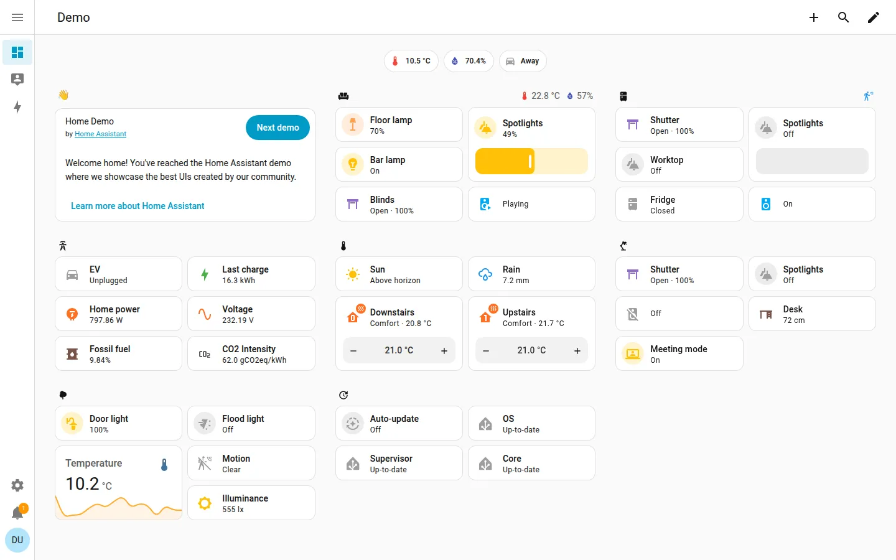

File: [desktop](public/home-assistant-desktop.webp), [mobile](public/home-assistant-mobile.webp). Source: <https://demo.home-assistant.io/#/lovelace/home>. Captured: 2026-10-07. Surface: **Home, Shell**. Public live demo; synthetic household data.

**TAKE:** Named rooms organize compact controls; device icons, labels and current state sit together. The mobile layout preserves the group hierarchy while stacking it. For Azizam, group app connection tasks by the member's intent before exposing engine inventory.

**NOT:** Toggle-looking controls for passive capability labels; physical-device metaphors for provider routing. **Bans present:** A4's repeated rounded-card grammar is visible; density is the useful part.

**Measurable trait:** At 390 px, each app action exposes its name and readiness in the same row, with a tap target at least 44 px high.

## R02 — GitHub Status: verdict before history

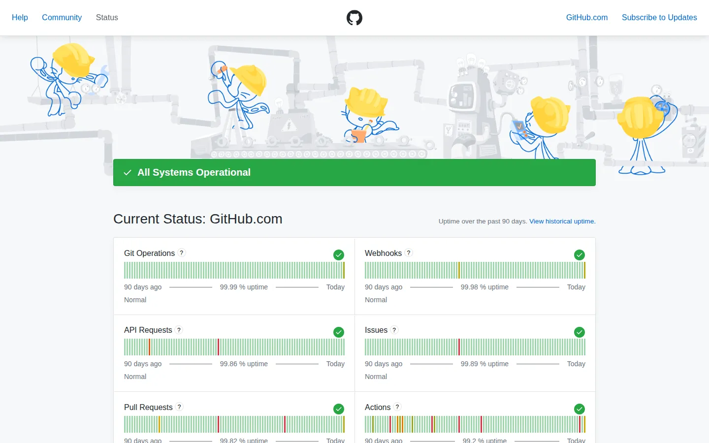

File: [desktop](public/github-status-desktop.webp), [mobile](public/github-status-mobile.webp), [full page](public/github-status-full.webp). Source: <https://www.githubstatus.com/>. Captured: 2026-10-07. Surface: **Status, Home**. Public live status page.

**TAKE:** A plain verdict band precedes the component list. Named components have textual status and history together; the desktop grid becomes a single mobile column. History stays subordinate to today's verdict.

**NOT:** The decorative illustration's vertical space or several restatements of “operational.” **Bans present:** C20 repetition between verdict, component status and the current-status heading; A4 repeated component cards.

**Measurable trait:** One verdict sentence of no more than 10 words appears within the first 300 px at both widths.

## R03 — OpenAI Status: capability groups and quiet disclosure

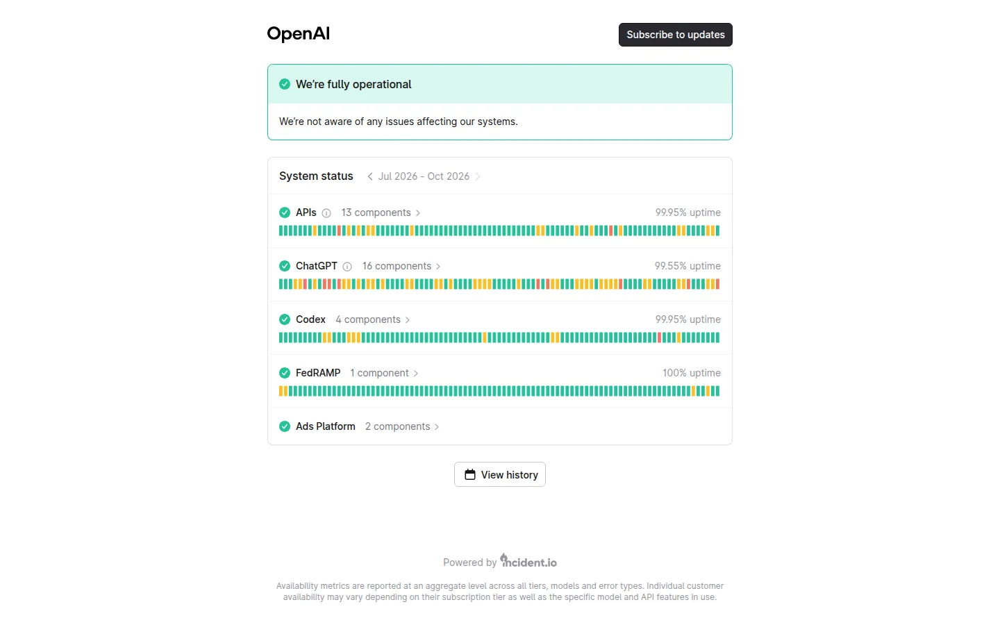

File: [desktop](public/openai-status-desktop.webp), [mobile](public/openai-status-mobile.webp), [full page](public/openai-status-full.webp). Source: <https://status.openai.com/>. Captured: 2026-10-07. Surface: **Status, Home**. Public live status page.

**TAKE:** A small verdict panel dominates a narrow reading column. APIs, ChatGPT, Codex, FedRAMP and API Platform are separate named groups; finer components sit behind disclosure. The same hierarchy is legible on a phone.

**NOT:** Treating aggregate uptime as proof that one household member's app works; the second sentence repeating the healthy verdict. **Bans present:** C20 verdict repetition; C27 much unused desktop width warrants a deliberate narrow composition rather than accidental emptiness.

**Measurable trait:** The first mobile viewport shows the verdict and at least four named capability groups without horizontal scrolling.

## R04 — Vercel Status: aligned labels and history tracks

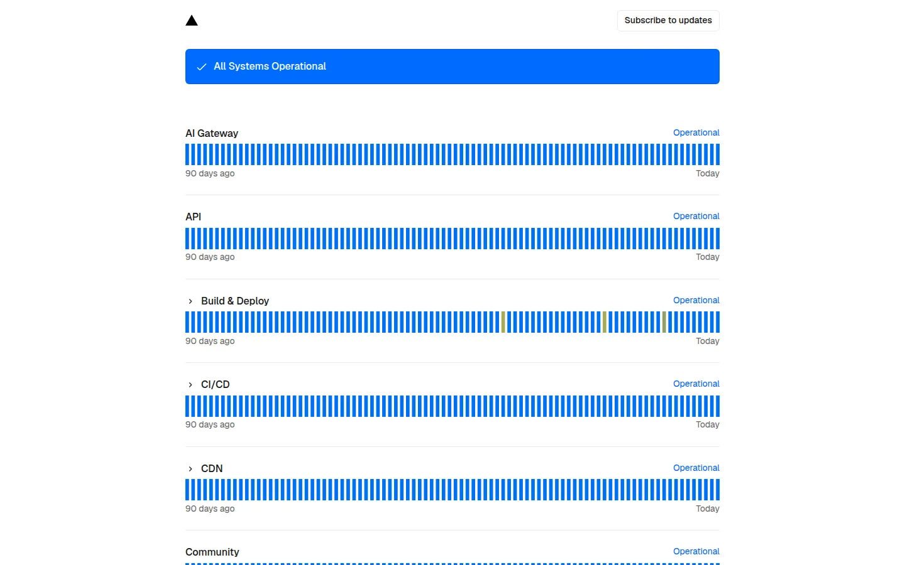

File: [desktop](public/vercel-status-desktop.webp), [mobile](public/vercel-status-mobile.webp), [full page](public/vercel-status-full.webp). Source: <https://www.vercel-status.com/> (the public status destination used here). Captured: 2026-10-07. Surface: **Status, Usage**.

**TAKE:** Each service has its name at left, a textual current state at right, and a history strip below. Uniform tracks let an operator scan across services; the mobile view keeps the row structure.

**NOT:** Blue bars as the sole meaning, or uptime graphics on Home when they change no member decision. **Bans present:** No numbered ban identified in the retained region; the repeated history strips still incur P1's attention cost.

**Measurable trait:** Every service row contains a written state, and all history tracks share one start and end time.

## R05 — Tailscale Status: compact infrastructure layers

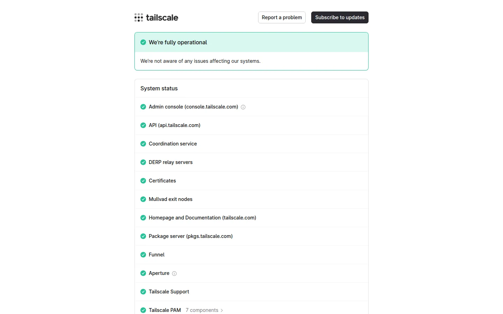

File: [desktop](public/tailscale-status-desktop.webp), [mobile](public/tailscale-status-mobile.webp), [full page](public/tailscale-status-full.webp). Source: <https://status.tailscale.com/>. Captured: 2026-10-07. Surface: **Status**.

**TAKE:** A dense list names distinct infrastructure layers: admin console, API, coordination service, relay servers and certificate service. Simple disclosure rows make a long service inventory navigable. This is useful for Azizam's gateway/provider/engine/workflow separation.

**NOT:** Service jargon on member Home, or a green dot without words explaining what it means. **Bans present:** C20 repeats the healthy verdict in explanatory copy. Healthy rows rely heavily on icons; add explicit state text for Azizam.

**Measurable trait:** An operator can see at least eight named layers in the first desktop viewport; every failed row adds a written layer and one next action.

## R06 — Uptime Kuma: dark operational list

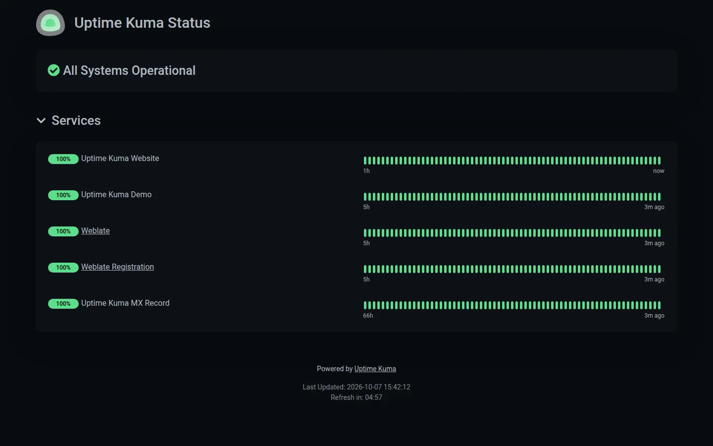

File: [desktop](public/kuma-desktop.webp), [mobile](public/kuma-mobile.webp). Source: <https://status.kuma.pet/>. Captured: 2026-10-07. Surface: **Status**. Public status page, not the private editing dashboard.

**TAKE:** One operational banner sits above one service group. Service names align in a left column and history tracks in a right column. Small footer timestamps distinguish the status snapshot from the refresh schedule.

**NOT:** Treating the “100%” pill as today's verdict or importing tiny uptime bars to phones without a readable alternative. **Bans present:** A2 near-black with a bright green accent; C18 pill-like read-only percentages are a resemblance risk, not evidence of interactivity.

**Measurable trait:** Each service shows a written current state separately from its percentage, and the last update time appears once.

## R07 — Grafana Play: operator shell and scrollable depth

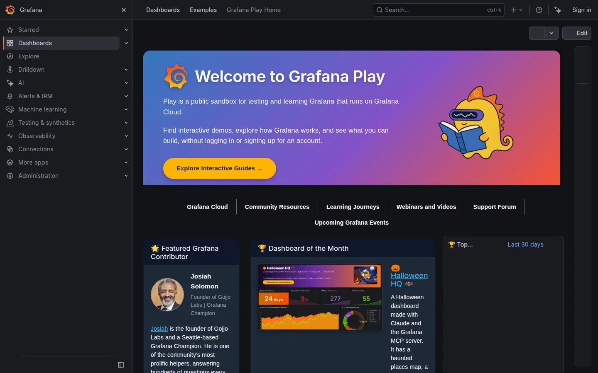

File: [desktop](public/grafana-desktop.webp), [mobile](public/grafana-mobile.webp). Source: <https://play.grafana.org/>. Captured: 2026-10-07 after waiting for startup. Surface: **Shell, Usage**. Public demo home; this entry does not claim to show a metrics dashboard.

**TAKE:** Persistent desktop navigation, a compact top rail and a bounded main content region separate location from content. Mobile folds navigation away rather than squeezing the sidebar into the reading area.

**NOT:** The welcome promotion, dashboard thumbnails as actual receipts, or Grafana's entire navigation hierarchy. **Bans present:** B15 slogan/promotion inside the demo; A4 repeated cards; a vivid gradient hero conflicts with the restraint required by P1.

**Measurable trait:** At 390 px, navigation consumes at most one 56 px top rail before the page's main answer.

## R08 — Model Context Protocol: content priority

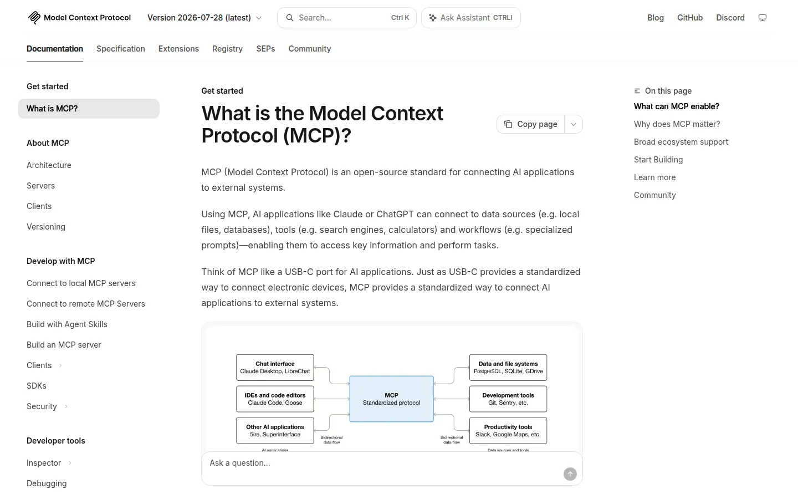

File: [desktop](public/mcp-desktop.webp), [mobile](public/mcp-mobile.webp). Source: <https://modelcontextprotocol.io/docs/2026-07-28/getting-started/intro>. Captured: 2026-10-07. Surface: **Home, Apps, Shell**. Owner-approved reference for structure, not visual styling.

**TAKE:** A question heading, concise definition and concrete explanation precede deeper navigation. Desktop separates section navigation, reading column and local contents; mobile prioritizes the article. Apply this order to “Connect an app”: answer, endpoint/key action, optional detail.

**NOT:** A documentation sidebar as the household app shell, or requiring members to understand the architecture diagram. **Bans present:** No numbered ban identified in the retained region.

**Measurable trait:** The connection page contains its first usable action within the first 500 px on mobile, before architectural explanation.

## R09 — Linear: list shell, working content, properties

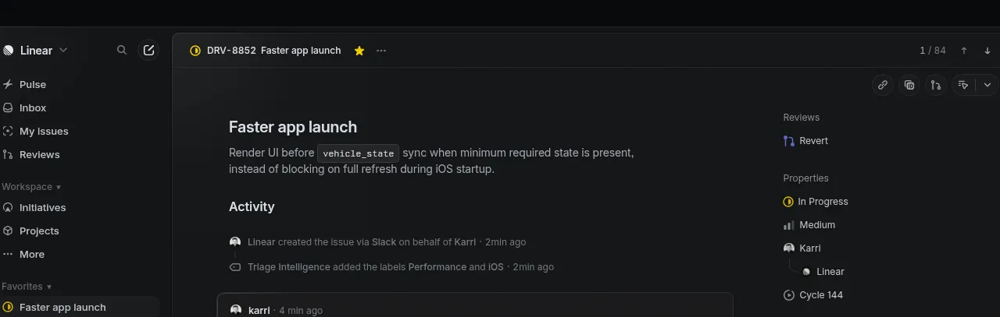

File: [UI crop](public/linear-ui.webp). Source: <https://linear.app/>. Captured: 2026-10-07. Surface: **Apps, Usage, Shell**. Official product imagery; crop of the desktop capture at x=80, y=493, width=1280, height=407. It shows the top of the product UI, not the full application. A separately fetched asset was blurred and was discarded.

**TAKE:** Navigation at left, a large working content column and a narrower properties column at right. The request/issue identifier lives in the top rail; properties are quiet, aligned and distinguishable from the activity narrative. Useful for a receipt detail view.

**NOT:** Issue-tracker terminology, icon-only actions without accessible labels, or importing the marketing page's hero. **Bans present:** No numbered ban identified in this crop; monospace is used appropriately for identifiers/code (B10).

**Measurable trait:** Desktop receipt detail has no more than three structural columns; metadata occupies no more than 25% of the content width.

## R10 — Stripe: cost report with comparison context

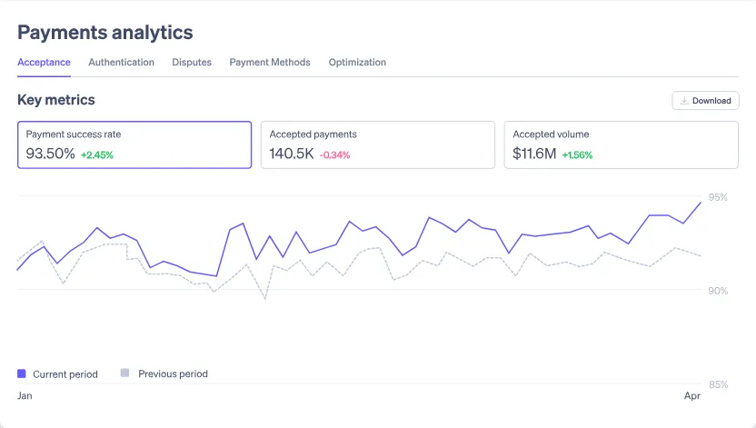

File: [UI crop](public/stripe-report-ui.webp). Source: <https://stripe.com/payments>. Captured: 2026-10-07. Surface: **Usage**. Official embedded “Stripe Dashboard report showing how to optimize cost” image, captured as an image element after scrolling it into view.

**TAKE:** Three compact metrics sit above one shared chart. Percentage, count and currency retain their units; current versus previous period is explicitly keyed. The chart is a comparison tool, not background decoration.

**NOT:** Invented business metrics, payments terminology for inference, or a chart with no records behind it. **Bans present:** A4's repeated outlined metric boxes; multiple navigation patterns in the source product would conflict with C21 if copied alongside another Azizam tab style.

**Measurable trait:** Every amount shows its unit and period; unknown cost is written “Unknown,” never an empty cell (C26).

## R11 — Plex: artwork-led browsing and household navigation

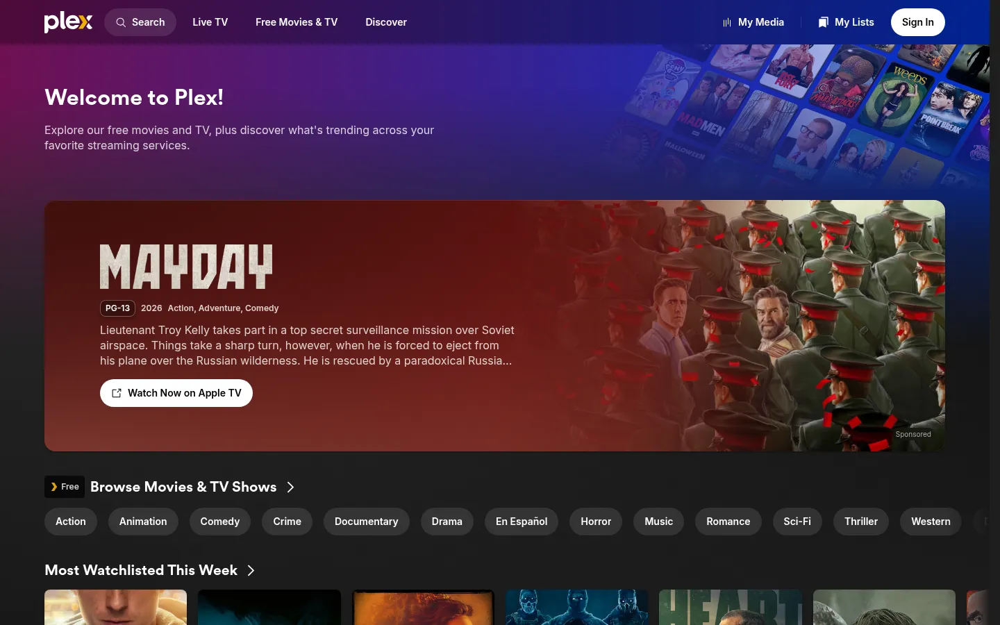

File: [desktop](public/plex-desktop.webp), [mobile](public/plex-mobile.webp). Source: <https://watch.plex.tv/> (redirected from plex.tv). Captured: 2026-10-07. Surface: **Library, Shell**. Public live browsing UI.

**TAKE:** Artwork, a selected title, media metadata and a clear play action form a hierarchy distinct from the lower browsing shelves. Mobile uses bottom navigation. Use artwork and playable previews to distinguish creations from operational records.

**NOT:** Promotional welcome content, external catalog recommendations, autoplay assumptions or genre-chip clutter. The captured mobile fold is dominated by the selected title; it is not evidence that a gallery fits above the fold.

**Bans present:** B13 pill-shaped primary action; B15 welcome promotion; C18 chip-like genre navigation must have real behavior; bright purple hero styling approaches A5.

**Measurable trait:** A creation preview exposes media type, duration for timed media and one play/open action; mobile bottom navigation has at most five destinations.

## R12 — Apple Photos: media first, controls at the edge

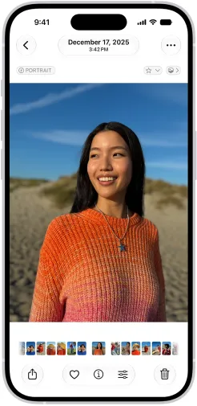

File: [photo viewer](public/photos-ui-0.webp), [video viewer](public/photos-ui-4.webp). Source: <https://support.apple.com/guide/iphone/view-photos-and-videos-iph3d267610/ios>. Captured: 2026-10-07. Surface: **Library**. Official shipped iPhone UI imagery, 245 × 504 displayed pixels, cropped to the device images. Source page visited at both requested widths; these are embedded illustrations, not a responsive web-app test.

**TAKE:** The creation occupies most of the screen. A small filmstrip retains browsing context; video adds transport, timeline and sound controls at the lower edge. Back navigation and creation actions do not compete with an operator sidebar.

**NOT:** Hover-only controls, tiny native touch affordances copied literally to the web, or native phone chrome. **Bans present:** No numbered ban identified in the image crops; compact icon controls still require accessible labels.

**Measurable trait:** The media occupies at least 65% of the viewer content area; play, seek and sound controls are visible for a video before playback.

## R13 — Tailscale invites: email and role in one task

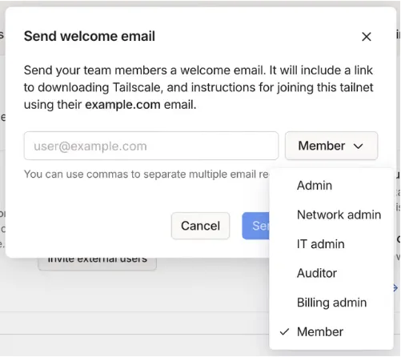

File: [invite form](public/tailscale-invites-ui-1.webp), [role menu](public/tailscale-invites-ui-2.webp). Source: <https://tailscale.com/kb/1064/invite-users>. Captured: 2026-10-07. Surface: **People**. Official admin-console imagery; cookie overlay dismissed before crop. No invitation was sent.

**TAKE:** One short explanation precedes email input and a role selector. The selected role has a checkmark; cancelling and sending are separate actions. Role choice belongs with the invitation rather than on a second settings page.

**NOT:** Enterprise role proliferation, comma-separated email entry for the household default, or claiming that sending email completes membership. **Bans present:** No numbered ban identified in the crops. The menu overlaps the submit control, so do not treat the image as a mobile layout specification.

**Measurable trait:** The default invite asks for one email and one role; the resulting receipt distinguishes “Invite sent” from “Joined.”

## R14 — Handoff: desktop overview with expanded quickstart

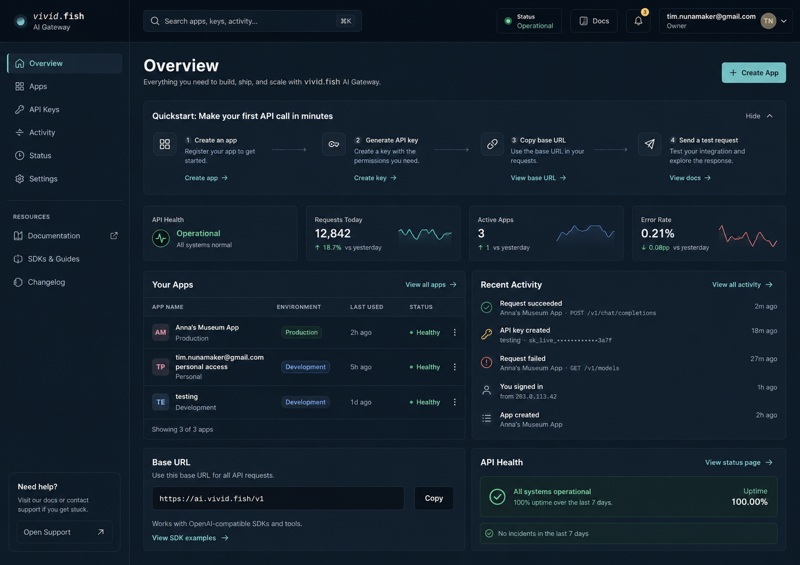

File/source: [owner handoff](../assets/reference-ui/admin-overview-desktop-quickstart.png), no public URL. Capture date: unknown; curated 2026-08-11, inspected 2026-10-07. Surface: **Home, Usage, Shell**.

**TAKE:** Deep-water atmosphere, compact sidebar/top rail, setup across the top, apps and recent activity in separate columns, and endpoint/health at the bottom. The secondary region gives the desktop composition useful depth.

**NOT:** Illustrative endpoints, keys, numbers or timestamps as product requirements. **Bans present:** A5 dashboard/KPI grammar, B6 small caps labels, B10 small monospace labels. Preserve approved density and contrast; give every metric real data and every label ordinary type unless it is copied/matched.

**Measurable trait:** Endpoint copy action appears in one place; at least one populated secondary region is visible below the main Home task at desktop width.

## R15 — Handoff: desktop welcome and horizontal setup

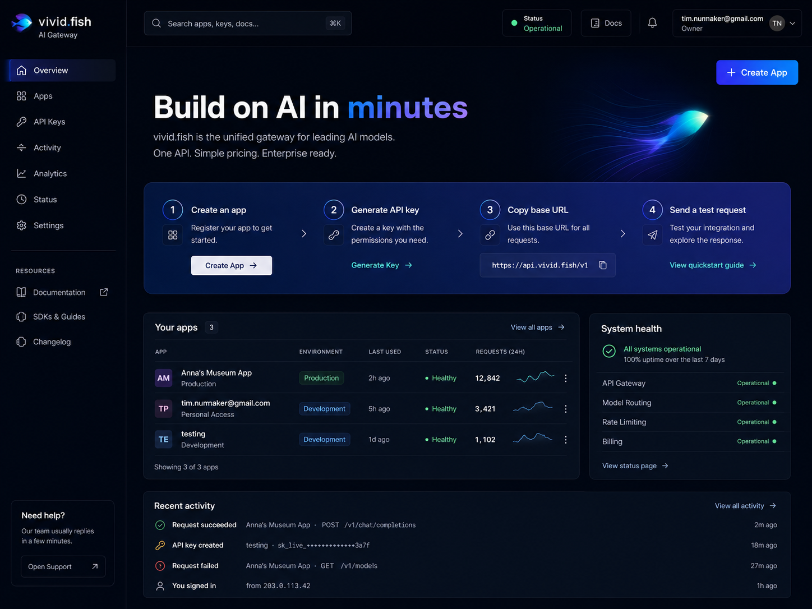

File/source: [owner handoff](../assets/reference-ui/admin-overview-desktop-welcome.png), no public URL. Capture date: unknown; curated 2026-08-11, inspected 2026-10-07. Surface: **Home, Shell**.

**TAKE:** Brand artwork gives the opening area a focal point. The real four-step setup sequence has a bounded horizontal band; app rows, system health and activity sit below with different roles and densities.

**NOT:** “Build on AI in minutes,” fabricated stats or setup instructions after setup is complete. **Bans present:** B15 slogan, A5 blue-violet glow, B6 small caps. B12 numbered steps are acceptable only as a real setup sequence.

**Measurable trait:** Setup has at most four steps and collapses to a single summary when complete; Home contains zero slogan headlines.

## R16 — Handoff: mobile quickstart and continuing composition

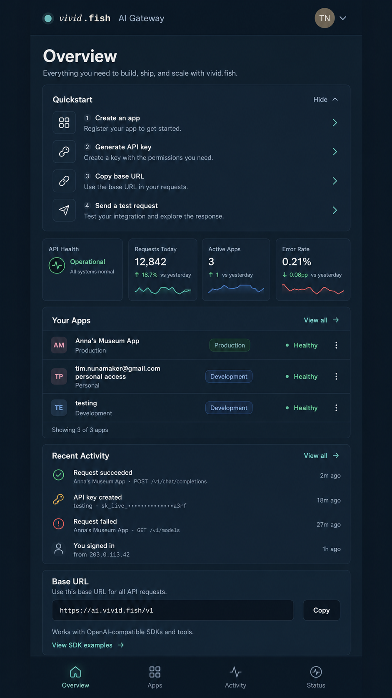

File/source: [owner handoff](../assets/reference-ui/portal-overview-mobile-quickstart.png), no public URL. Capture date: unknown; curated 2026-08-11, inspected 2026-10-07. Surface: **Home, Apps, Shell**.

**TAKE:** The desktop regions become a deliberate vertical sequence: setup, compact metrics, apps, activity, endpoint and health. Bottom navigation preserves orientation while content continues below the first fold.

**NOT:** Squeezing the desktop operator's telemetry into every member visit or treating the long mock as proof that each section earns attention. **Bans present:** A5 KPI grammar, B6 small caps, B10 small monospace labels; fixed navigation requires special handling in full-page captures (D31).

**Measurable trait:** At 390 px, one readiness sentence and the main connect-app action fit above the fold; the endpoint is not repeated in setup and footer.

## R17 — Handoff: mobile welcome with brand artwork

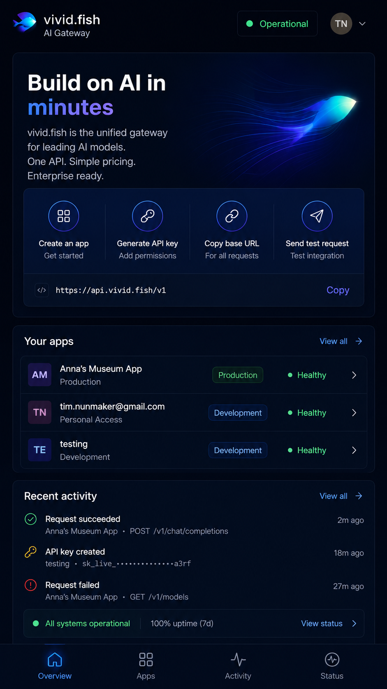

File/source: [owner handoff](../assets/reference-ui/portal-overview-mobile-welcome.png), no public URL. Capture date: unknown; curated 2026-08-11, inspected 2026-10-07. Surface: **Home, Library, Shell**.

**TAKE:** A compact artwork moment, app list, recent activity and bottom navigation establish a member-facing portal. Content regions have distinct visual weights rather than identical cards throughout.

**NOT:** Marketing language or implied service availability unsupported by readiness data. **Bans present:** B15 slogan, A5 blue glow, B6 small caps, B10 small monospace labels.

**Measurable trait:** The decorative artwork occupies no more than 20% of the first mobile viewport, leaving the main task visible.

## R18 — Handoff: incident banner, service table, history

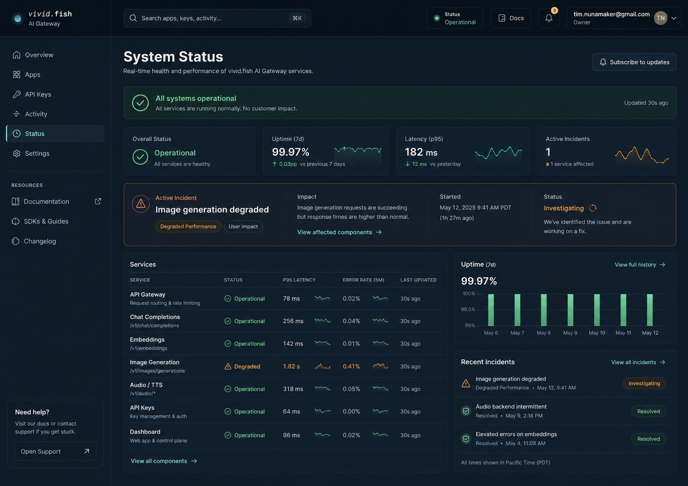

File/source: [owner handoff](../assets/reference-ui/admin-status-desktop-incident-table.png), no public URL. Capture date: unknown; curated 2026-08-11, inspected 2026-10-07. Surface: **Status, Usage**.

**TAKE:** Verdict at top, incident band next, service table at left and history at right. The incident has a named subject, severity and explanatory space. This supplies a failure composition absent from the healthy public captures, but its facts remain illustrative.

**NOT:** Simultaneously declaring everything operational and degraded without explaining scope; invented uptime/latency values. **Bans present:** C20 risk from repeating incident facts; B14 coloured left-edge status treatment; A5 telemetry grammar; B6/B10 labels.

**Measurable trait:** An active incident appears before the service table and contains exactly one layer label and one next-action sentence.

## R19 — Handoff: status hero and bounded telemetry

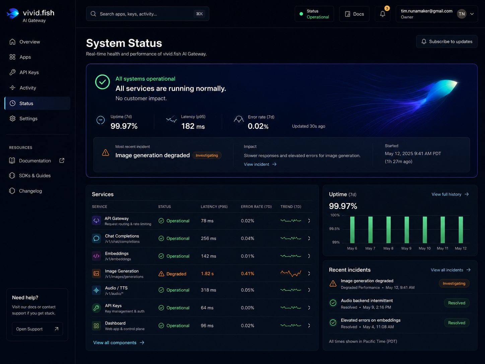

File/source: [owner handoff](../assets/reference-ui/admin-status-desktop-hero.png), no public URL. Capture date: unknown; curated 2026-08-11, inspected 2026-10-07. Surface: **Status, Home**.

**TAKE:** Strong status sentence, subordinate operational metrics and brand art share one bounded opening panel. A dense service table and narrow history column create depth below it.

**NOT:** Making the artwork louder than the failure or using a reassuring global verdict when one affected capability needs attention. **Bans present:** A5 dashboard/glow grammar; B14 coloured incident edge; B6/B10 labels; C20 repetition between hero and incident summary needs checking.

**Measurable trait:** The current verdict uses larger type than every KPI label and remains visible without scrolling at both widths.

## R20 — Handoff: Apps & Access with selected detail

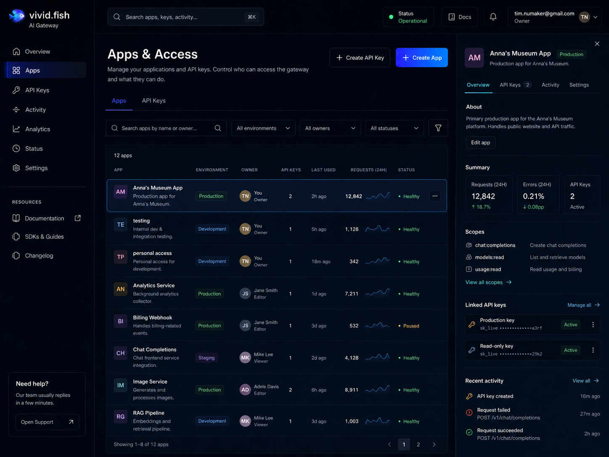

File/source: [owner handoff](../assets/reference-ui/admin-apps-access-desktop-selected-detail.png), no public URL. Capture date: unknown; curated 2026-08-11, inspected 2026-10-07. Surface: **Apps, People, Usage, Shell**.

**TAKE:** A selected row stays visible beside a right context panel. Summary, scopes, linked keys and activity are separate sections; the table answers which app while the panel answers what it can do and what happened.

**NOT:** Key-looking example strings as real credentials or a detail panel cramped beside a table on mobile. **Bans present:** B6 small caps, B10 monospace descriptive labels; filter chips risk C18; A5 dark-dashboard grammar needs real data.

**Measurable trait:** Exactly one row is selected, and its name matches the detail heading; at 390 px the detail becomes a full-width view or sheet.

## Anti-references — current Azizam, not direction candidates

Source for all six: `/home/tnunamak/Documents/azizam/ux-findings/screens/2026-10-07/` (local capture collection, no public URL). Capture collection date: **2026-10-07**. Copies are converted to WebP quality 80 and limited to 1440 px wide; original PNGs remain untouched. The owner's “amateur” and “claudy” rejections apply to this visual family; do not infer an individual quote for each file.

| ID | File (same basename as original PNG) | Surface | What to reject / measurable replacement |
|---|---|---|---|
| A01 | [Status, light desktop](anti/status-seeded-light-1440.webp) | Status | “Partially checked” leads the screen; C16, A1 and C27. Replace with one classified verdict plus scope and next action. |
| A02 | [Home, light desktop](anti/home-seeded-light-1440.webp) | Home | Cream/serif template (A1), repeated “Gateway default” (C20), wide sparse composition. One endpoint/default fact once; compose a useful secondary region. |
| A03 | [Usage, light desktop](anti/usage-seeded-light-1440.webp) | Usage | “No paid requests” styled as a large numeral (C17), tiny sparse figures in a broad field. Numbers keep units; narrative empty states use sentence-sized type. |
| A04 | [Models, light desktop](anti/models-seeded-light-1440.webp) | Apps | A1 plus a mostly empty table across a broad canvas (C27). Reduce the reading measure when there are few rows; do not invent content to fill it. |
| A05 | [Status, dark desktop](anti/status-seeded-dark-1440.webp) | Status | Dark mode retains the same C16 verdict and sparse hierarchy. Changing the palette does not classify the state; test one scope-specific verdict in both themes. |
| A06 | [Home, light mobile](anti/home-seeded-light-390.webp) | Home | A1 and C20 persist in the stacked composition. Keep the connect action and readiness above the fold; remove repeated facts before adding sections. |

## Source outcomes and limitations

| Source attempted | Outcome |
|---|---|
| Home Assistant, Grafana Play, GitHub/OpenAI/Vercel/Tailscale status, Uptime Kuma status | Retained live public UI. Grafana initially showed startup; retry waited for its real demo home. |
| Linear | Retained a real product-UI region from the original desktop screenshot. A later page retry hit a QUIC error and a direct image capture was blurred; both are excluded from board imagery. |
| Stripe | Retained official embedded dashboard report. A later page retry failed to connect; the earlier successful report crop remains. |
| Tailscale product page | Homepage was not useful console evidence. The guessed `/kb/1134/users` redirected to an IPv4 FAQ; excluded. The official invite article supplies R13. |
| Apple Photos | `/ios/photos/` redirected to the official iPhone guide. Retained real photo/video viewer imagery from it. |
| Plex | Redirected to public `watch.plex.tv`; retained live household-media browsing UI. |
| Immich demo | Skipped before UI navigation: robots includes a generic `Disallow: /`, alongside share/asset allowances. Conservatively excluded the demo root. |
| Open WebUI demo | `demo.openwebui.com` DNS lookup failed; no capture retained. |
| LibreChat demo | Redirected to `/login`; skipped, no login attempted or login screenshot retained. |
| Raycast, 1Password, Plaid | Public pages loaded, but initial views were marketing/illustration rather than adequate product-UI evidence. Excluded; no claim that they require login. |
| Vercel dashboard product imagery | Not separately captured; R04 covers its public status interface only. |

Public pages were captured without bypassing access controls or entering private routes. `sources.json` retains robots responses and original/resolved URLs; missing robots files returned 404 on several status/demo hosts. The original `capture.cjs` records the private browser workflow; retained crops and full-page retries are described above. `files.json` records dimensions and byte counts for every included WebP. Images are internal design evidence, not licensed production assets. This board does not authorize reusing artwork in Azizam.

No active public outage was captured. R04’s full page includes real historical incident text, but does not establish the current failure interaction. R18's incident layout is handoff evidence, not live outage evidence. Public demo and official marketing images cannot establish actual Azizam usage, cost, permissions or service health. Confidence is high in the captured layouts; responsive behavior is evidenced only where desktop and mobile live captures are linked.
