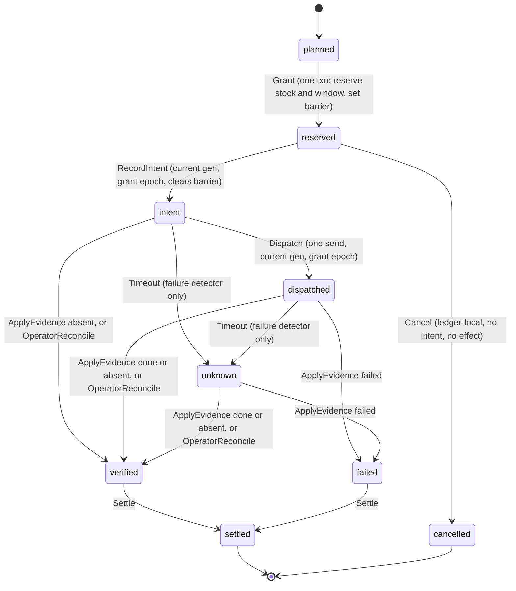
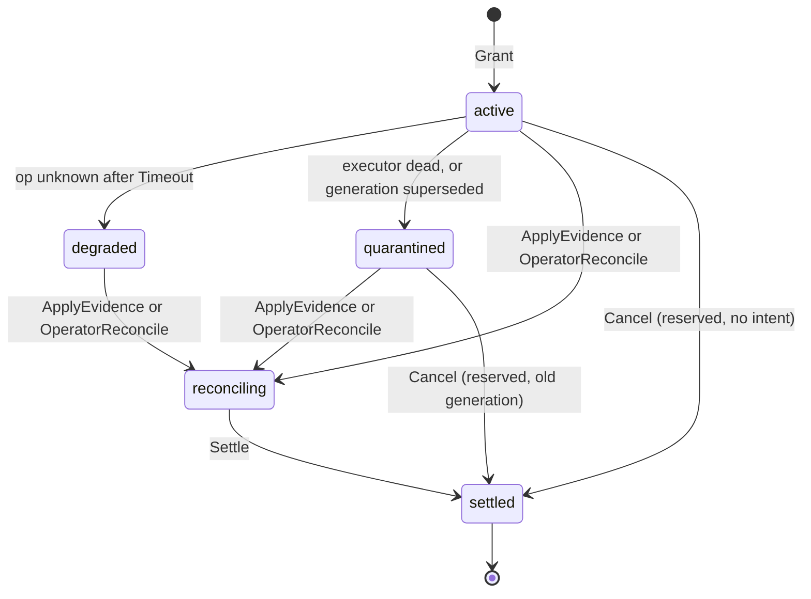

# Ledger model: resource accounting and the external-effect protocol

TLA+ model of FOUNDATION.md §3.1, §3.3, and §4.1–4.5. It checks the design. It is not product code.

| File | What it is |
|---|---|
| `Ledger.tla` | The model. One module, all actions, invariants, and liveness. |
| `Ledger.cfg` | The good protocol. TLC result: no error. |
| `Ledger-broken-timeout.cfg` | Broken variant the task asked for: a timeout releases a holding. TLC finds a counterexample. |
| `Ledger-broken-stale-report.cfg` | Extra broken variant: an old-epoch window report restores current credit. TLC finds a counterexample. |
| `Ledger-unfenced.cfg` | Extra config: adapter with no fence at takeover (`Fenced = FALSE`). TLC finds a counterexample. This is a design finding, not a model bug. |

Run (from any directory, with `-metadir` so TLC writes no `states/` next to the spec):

```
java -cp ~/.local/share/mise/installs/http-tla2tools/1.7.4/tla2tools.jar \
  tlc2.TLC -workers auto -metadir <scratch>/states -config Ledger.cfg Ledger.tla
```

Sizes: 2 attempts (`a1` needs 2 stock units, `a2` needs 1; each needs 1 window unit), stock capacity 2, window limit 1 unit per epoch, 2 epochs, 2 executor generations.

## What is modeled

- **Two resources.** One *stock* (`StockCap`, released on settlement, not on the release action). One *window budget* with epochs. A grant charges the current epoch. Replenishment starts the next epoch and never refunds the old one.
- **Attempts and effects.** Each attempt makes one external effect under one idempotency key. The lifecycle is `planned → reserved (+ barrier) → intent → dispatched → verified | failed → settled`, with `unknown` (after a timeout) and `cancelled` (ledger-local release before intent). See the diagram below.
- **Environment events**, each a nondeterministic action in `Next`:
  - grant (`Grant`)
  - dispatch and engine accept (`Dispatch`, `Accept`), including redelivery of an old message (the in-flight set never drops a message)
  - engine finish (`FinishOk`, `FinishFail`)
  - crash of the executor, which loses volatile state while the durable ledger and in-flight messages survive (`Crash`)
  - restart with a new generation (`Restart`); the fence is raised in the same step if `Fenced`
  - duplicate and reordered evidence (`Emit` writes into a set, and `ApplyEvidence` can run at any time)
  - stale window report from an old epoch (`EmitReport`)
  - window replenishment (`Replenish`)
  - timeout as a failure detector only (`Timeout`)
  - audited operator reconciliation (`OperatorReconcile`)
- **Engine model.** Each key is single-use (`none → running → done|failed`). Answering "absent" to a query tombstones the key (`none → tomb`), so a late dispatch of that key is refused. With `Fenced`, the engine refuses any message from a generation older than its fence.

## What is abstracted away

- **Resource kinds.** No `balance` (so the "completion never refunds a balance" clause is not checked), no `opaque_budget`, no outside-use term, no uncertainty term, no reserve, no coupling or `alias_of`, no `parent`.
- **Holders.** No residency (no shared engine charge, no delta baseline), no outside holders, no member sets.
- **Claims.** Single fixed demand. No phase graph, no amendable growth, no wait-for cycles (§4.5 is not modeled), no claim functions.
- **Time.** Timeouts and deadlines are untimed. `Timeout` may fire at any point, which is the most adversarial reading of a failure detector. No milestone deadlines, no settling periods, no validity horizons.
- **Policy.** No classes, compatibility, gates, principal budgets, or service objectives. Policy revision and evidence revision are not versioned.
- **Holder `degraded` and `reconciling`.** Entry rules are not in the design (see A7), so the mapping in `HolderState` is ours.
- **Evidence kinds.** One adapter. Recovery evidence is only the engine's authoritative status. Process-exit evidence is not modeled, and neither is proof of incarnation replacement.
- **Network.** Messages can be redelivered and delayed, but never dropped. Dropped dispatches are the same as never-accepted dispatches, which the absent-evidence path covers.
- **Engine effect time.** An effect runs atomically at accept, and completion is a separate step.
- **Barrier.** One global barrier (2 resources). The design's per-domain barrier is not modeled.
- **Drift.** Capacity never shrinks, so the drift and quarantine path is unreachable in this model.

## Invariants in plain words

Safety invariants, checked on every reachable state:

1. **NoOverGrant.** Granted stock never exceeds stock capacity. Window use in each epoch never exceeds the window limit.
2. **WindowNoRefund.** In each epoch, window use equals units granted minus units returned by pre-dispatch cancels. Completion, settlement, and old-epoch reports change nothing. This covers "completion never refunds a window" and "window credit is never restored by an older-epoch report".
3. **SettledHasEvidence.** A settled holding has an audited basis: holder-scoped engine evidence for that attempt, or an operator reconciliation.
4. **NoStaleEffect.** No effect starts from a message whose generation is older than the current owner's.
5. **NoDoubleEffect.** Each idempotency key is sent at most once and starts at most one effect. There is no blind replay.
6. **ReleasedNoRunning.** A settled or cancelled holding has no engine effect still running behind it.
7. **TypeOK.** Shapes hold, and every holder state is one of the five named states (plus `none` for planned attempts).

Action property (a temporal formula over step pairs):

8. **TimeoutNeverSettles.** No step moves an attempt from `intent` or `dispatched` directly to `settled`. A timeout can only move it to `unknown`.

Liveness, under `Fairness` (weak fairness on evidence arrival, engine finish, applying evidence, settling, and ledger cancel; no fairness on grant, record-intent, dispatch, restart, timeout, or operator reconciliation):

9. **Live.** Every attempt in `intent`, `dispatched`, or `unknown` eventually settles. So with evidence arriving, every holding settles.
10. **ReservedResolves.** Every `reserved` attempt eventually records an intent or is cancelled.

## TLC results

Environment: TLC 2.19, 24 workers, 27 GB heap. The good run explores the full reachable state space, not a sample. The broken runs stop at their first violation, so their counts are partial.

| Config | Result | States generated | Distinct states | Depth | Time (TLC search) |
|---|---|---|---|---|---|
| `Ledger.cfg` (good) | **No error.** 7 invariants and 3 properties hold. Temporal branches checked over the full graph. | **284,323** | **61,240** | **23** | **3 s** (average outdegree 1, max 7) |
| `Ledger-broken-timeout.cfg` | **Invariant `SettledHasEvidence` violated.** Counterexample of **4 states** (below). | 111 (stopped at the violation) | 93 | 6 (search depth at stop) | < 1 s |
| `Ledger-broken-stale-report.cfg` | **Invariant `WindowNoRefund` violated.** Counterexample of **5 states**. | 772 | 447 | 7 (search depth at stop) | < 1 s |
| `Ledger-unfenced.cfg` | **Invariant `NoStaleEffect` violated.** Counterexample of **7 states**. | 1,495 | 709 | 8 (search depth at stop) | < 1 s |

Checks on the checks (scratch runs, not part of the deliverable):

- **Non-vacuity.** Fifteen reachability probes, each an invariant that should be violated. All 15 states are reachable. They include: a second generation, a settled holding with evidence, a settled holding with an operator basis, a quarantined holder, a stale-generation message in flight, a fenced-away old message, a redelivered message after `done`, a tombstoned key, a cancelled holding, a failed holding, an unknown holding, an intent past its epoch, an old-epoch report, full stock, and a planned attempt waiting on the barrier.
- **Liveness has teeth.** `Live` with the same `Next` but without `Fairness` is violated. Fairness is doing real work.
- **The action property has teeth.** `TimeoutNeverSettles` alone, on the timeout mutant, is violated (240 states generated, 171 distinct). The timeout mutant is caught by the action property as well as by the state invariant.

### Counterexample summaries

**Broken timeout** (`Mutant = "timeoutSettles"`, the variant the task asked for). Four states:
1. Init.
2. `Grant(a2)`: a2 reserves 1 stock and 1 window unit in epoch 1, and the barrier is set.
3. `RecordIntent(a2)`: a2 is `intent`, with the barrier cleared.
4. `Timeout(a2)`: the mutant moves a2 straight to `settled` with `basis = "none"`. No engine evidence exists, and the engine has not run anything. `SettledHasEvidence` fails. `TimeoutNeverSettles` fails on the same step.

**Broken stale report** (`Mutant = "staleReportRefund"`). Five states:
1. Init.
2. `Replenish`: epoch 2 begins.
3. `Grant(a1)`: a1 takes the epoch-2 window unit. `winUsed[2] = 1`, `grantedW[2] = 1`.
4. `EmitReport`: an aggregate report for epoch 1 is recorded.
5. `ApplyStaleRefund`: the old report is applied to the current window. `winUsed[2]` drops to 0 while `grantedW[2] = 1`. `WindowNoRefund` fails.

**Unfenced adapter** (`Fenced = FALSE`, no fence raised at takeover). Seven states:
1. Init.
2. `Grant(a2)`.
3. `RecordIntent(a2)`.
4. `Dispatch(a2)`: message `{att: a2, gen: 1}` is in flight.
5. `Crash`: the gen-1 executor dies. Its message survives in the network.
6. `Restart`: owner becomes gen 2. Nothing fences the engine.
7. `Accept` of the gen-1 message: the engine starts the effect. `staleAccept = TRUE`. `NoStaleEffect` fails.

The good model rules this out because `Restart` raises `engFence` to the new generation in the same step as the ownership change. The engine then refuses the gen-1 message.

## Mermaid: operation protocol

Validated with `mmdc`.



## Mermaid: holder states

Holder states are derived from operation state (`HolderState` in `Ledger.tla`), so every edge below is an operation transition seen from the holder.



A restart never returns an old-generation holder to `active`. The new generation moves it on only through evidence, or through operator reconciliation.

## Design findings

Each item cites the section, says what is ambiguous or contradictory, and states the resolution the model uses. Items with a **[gap]** tag are holes in the design that the model shows.

- **A1. Is the intent in the grant transaction?** §4.1 says the grant transaction commits "the operation intent (§4.3)". §4.3 makes "intent recorded" a separate state after "reserved (and barrier set)". Resolution: a separate durable write (`Grant`, then `RecordIntent`). A crash between them leaves a reservation with no intent, and the model recovers it by cancel. If the design means one transaction, `RecordIntent` goes away and that window closes. The text should say which.

- **A2. Barrier semantics are undefined.** §4.3 says new admissions "either come before it or wait", without saying what "before" means or which domain the barrier covers. Resolution: one global barrier. It is set by `Grant`, blocks other grants, and clears at `RecordIntent` or `Cancel`.

- **A3. [gap] Window charge across an epoch rollover.** §4.2 says "reports from older windows cannot add credit" and "committed in this window". It does not say which epoch an operation charges when grant and dispatch fall in different epochs. Resolution: the charge belongs to the grant epoch. `Dispatch` is allowed only in the grant epoch. A reservation left over from an old epoch is cancelled, and an intent left over from an old epoch waits for absent-evidence to settle. The gap: a dispatch that is already in flight when the epoch rolls over may consume provider credit in the new window, and the ledger cannot see that. The design must choose between "dispatch only in the grant epoch" (the model's choice) and an explicit re-charge rule.

- **A4. [gap] Who raises the fence, and when?** §4.3 says the fence is "monotonic, where the adapter supports one", and does not say when it is raised. Resolution: raised in the same step as the ownership change (`Restart`). Without that, the engine keeps admitting the old generation's message. The unfenced counterexample above is this case.

- **A5. [gap] Unfenced adapters and messages already sent.** §4.3 says "only one controlled executor may act" and "failover action is refused while the previous executor's authority is uncertain". For an unfenced adapter, process exit proves the executor is dead, but not that a message it already sent has been dropped. Nothing in the text bounds that. The model's `Ledger-unfenced.cfg` violates `NoStaleEffect`. The obvious fix, waiting out the §6 delay bound before takeover, makes time a safety input. §3.3 forbids that for settlement ("a timeout is only a failure detector"). The design has to decide whether a delay bound may gate takeover.

- **A6. [gap] Operator reconciliation can release a holding while the engine can still run it.** §4.4 makes operator reconciliation settle a holding and says it is audited. It does not say the key must be fenced first. Without that, a dispatch in flight can run after the holding is released, and `ReleasedNoRunning` fails. Resolution: `OperatorReconcile` is allowed only when the engine is not running, and it tombstones the key. The design should write that down as a requirement on the operator path.

- **A7. Holder states and operation states do not line up.** §4.4 names five holder states. It gives no entry rule for `degraded` ("evidence is weak", with no threshold), and no meaning for `reconciling`. It also never maps the operation states `unknown` or `failed` to a holder state. §4.3 lists `failed` and `unknown` as states, but no edges into or out of them. Resolution: the mapping in the holder diagram. `unknown` comes only from a timeout. `failed` comes only from authoritative failed evidence. `reconciling` covers evidence in hand or an operator decision waiting to be applied. `degraded` is reached but has no threshold.

- **A8. [gap] "Every attempt gets a durable decision by its deadline" versus holdings that wait on evidence.** §6 promises a durable decision by the deadline. §4.4 says a holding stays until evidence settles it, and a timeout cannot settle. A dispatched attempt whose evidence never arrives therefore has a holding that is unresolved past its deadline. The model's `Live` depends on evidence arriving, so it cannot prove that promise. Resolution: the model separates the caller's decision (not modeled) from settlement (modeled). The design must say that, or say what decision a holder gets when evidence never comes.

- **A9. Cancelling a reservation with no intent.** §4.3 does not say how a reservation that never reached an intent is released. §3.3 says holdings settle only on evidence. Resolution: `Cancel` is a ledger-local release, allowed only with no intent, and it is not a settlement. It undoes the window charge in the grant epoch. The design should name this path, because it is the only release that needs no evidence.

- **A10. Stock release: action or settlement?** §3.1 says stock "returns capacity when it is released", and §3.5 says release hooks "only trigger reconciliation". "Release" is therefore ambiguous. Resolution: stock returns only on settlement or cancel, never on a release action. This follows §3.5.

- **A11. Evidence freshness.** §3.5 requires evidence "newer than the action's causal boundary". The boundary is not defined. Resolution: the model accepts any holder-scoped evidence for an attempt, because the engine's single-use key already prevents a second effect. A freshness rule is therefore not checked. The design needs to define the boundary if it wants this check.

- **A12. [gap] The engine must tombstone on absent.** The model's absent-evidence path depends on the engine refusing a late dispatch of a key after reporting it absent. §4.3 does not require that. Without it, "absent" can be followed by a late accept, and `ReleasedNoRunning` fails. Resolution: `Emit` on absence tombstones the key. This is an engine contract requirement that the adapter section should state.

Summary for the design owner: six items are design holes, tagged [gap]: A3, A4, A5, A6, A8, and A12. A1 is a direct contradiction in the text. The other five (A2, A7, A9, A10, A11) are missing definitions. A4 and A5 both come from the fence, so the fencing rules should be written as one unit.

## Checks on the model itself

- The first pass had a precedence bug. In `Accept`, `staleAccept' = staleAccept \/ (...)` parsed as `(staleAccept' = staleAccept) \/ (...)`. It was caught when the unfenced run reported an unassigned variable. Fixed by parenthesizing. The good-model counts did not change, because the bad branch is only reachable with `Fenced = FALSE`. The good run was re-run after the fix.
